# EduFlow CRM

[](https://github.com/Ulugbek-Ar/eduflow-crm/actions/workflows/ci.yml) · versiya 1.0.0 · ma'lumot sxemasi v10

**O'quv markazlari uchun CRM.** Lidlar va mijozlar, to'lovlar va kassa, qarzdorlar, kurslar, hisobotlar, xodimlar va rollar —
bitta brauzer ilovasida. Interfeys o'zbek (lotin) va rus tillarida, telefonda ham qulay, yorug' va qorong'i mavzu bor.

| Manzil | Nima |
| --- | --- |
| `/` | Landing: imkoniyatlar, tariflar, savol-javob, "Bepul sinab ko'rish" |
| `/app` | Ilovaning o'zi (kirish, ro'yxatdan o'tish, "Demo'ni ko'rish") |
| `/app?demo=1` | To'g'ridan-to'g'ri demo markaz (alohida, sizning ma'lumotingizga tegmaydi) |
| `/owner` | Sotuvchi paneli: markazlar, tariflar, muddatni uzaytirish, to'xtatish |
| `/privacy`, `/terms` | Maxfiylik siyosati va foydalanish shartlari (namuna — yurist bilan to'ldiring) |

- **Asosiy sayt — Vercel** (`vercel.json`): `main` branch'ga har push'da yangilanadi.
- **Namoyish — GitHub Pages:** https://ulugbek-ar.github.io/eduflow-crm/ — faqat demo (`VITE_DEMO_ONLY=1`), ro'yxatdan
  o'tish yo'q, "Ro'yxatdan o'tish" asosiy saytga yo'naltiradi (`MAIN_SITE_URL` repozitoriya o'zgaruvchisi).

Standart parol yo'q: birinchi ochilishda **sozlash ustasi** markaz nomi va administrator hisobini yaratadi.

> **Ishga tushirish (Supabase, Vercel, Pages, domen) — qadam-baqadam runbook: [DEPLOY.md](DEPLOY.md).**

| Yorug' mavzu | Qorong'i mavzu |
| --- | --- |
| 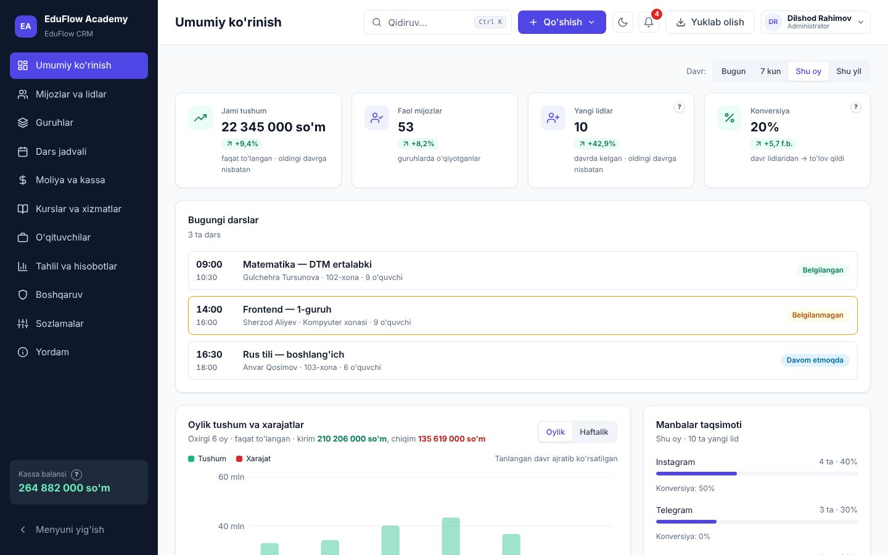 | 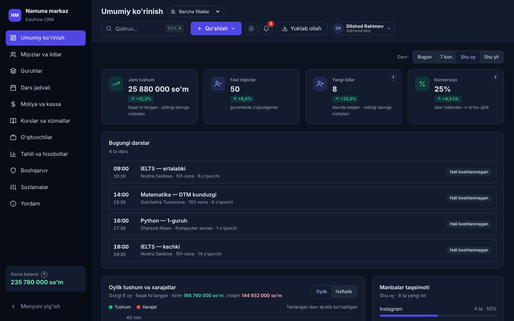 |
| 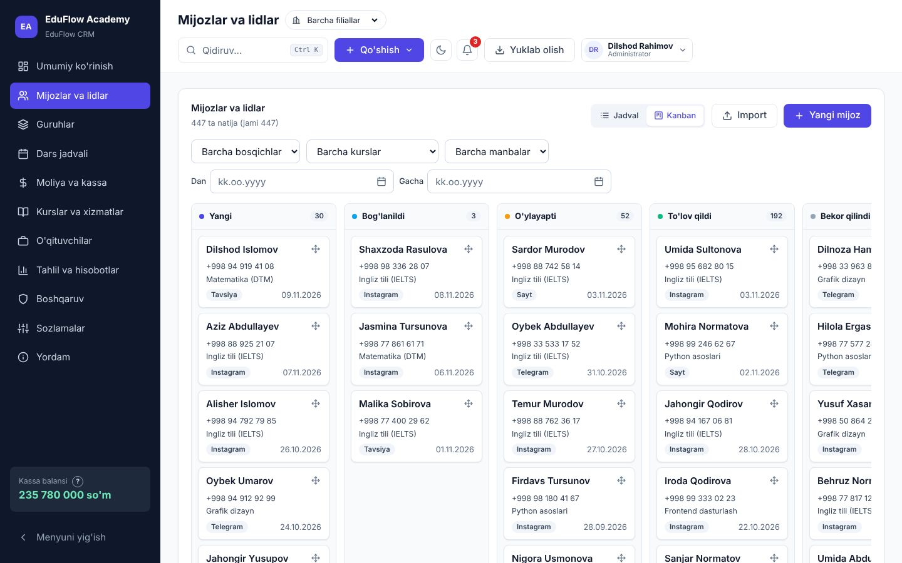 | 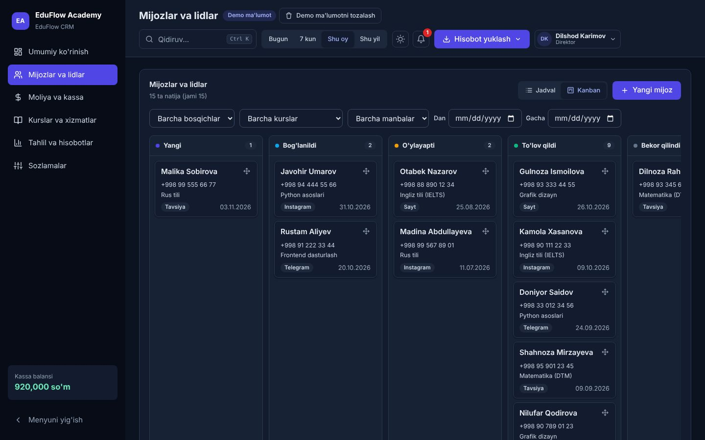 |
| 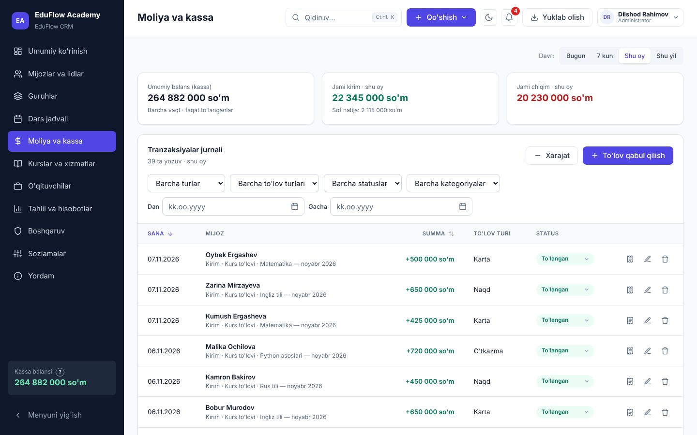 | 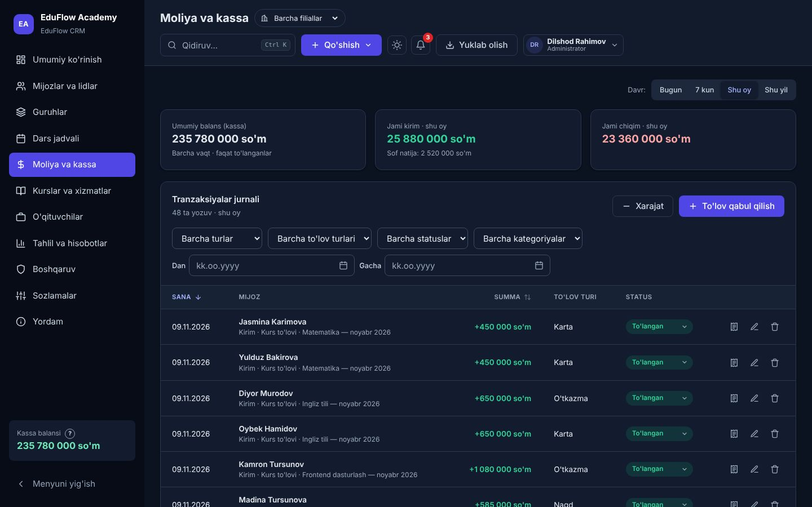 |
| 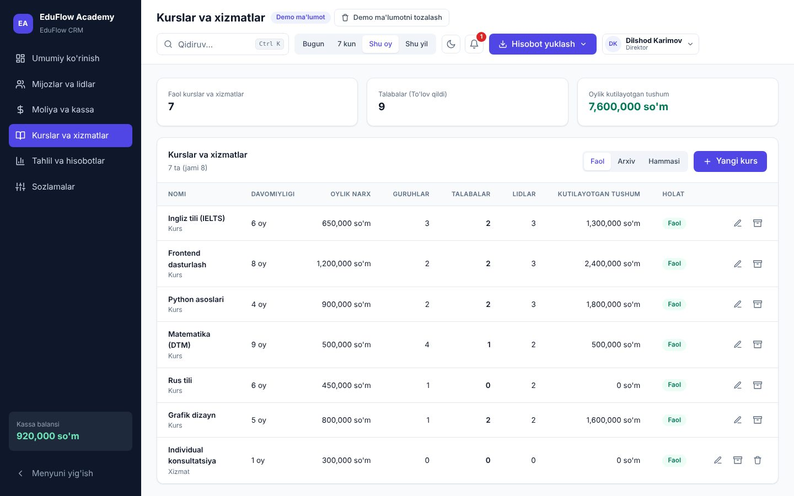 | 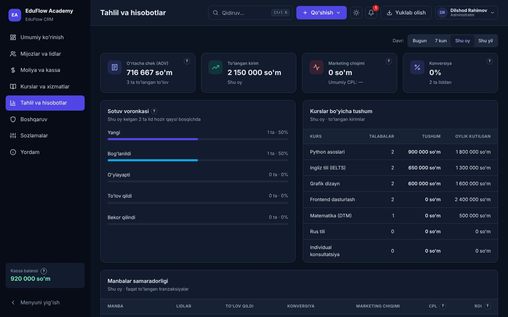 |
| 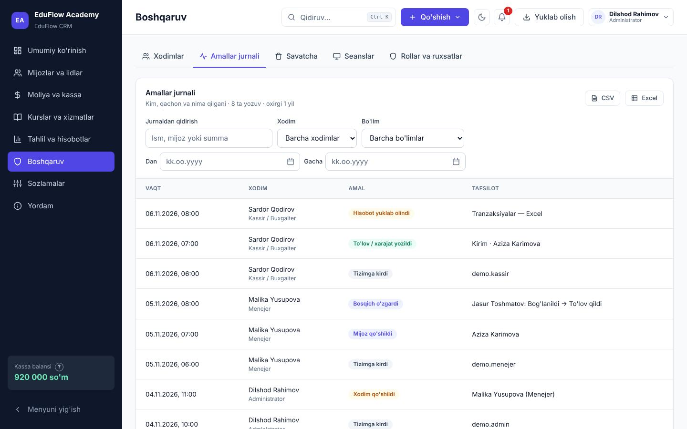 | 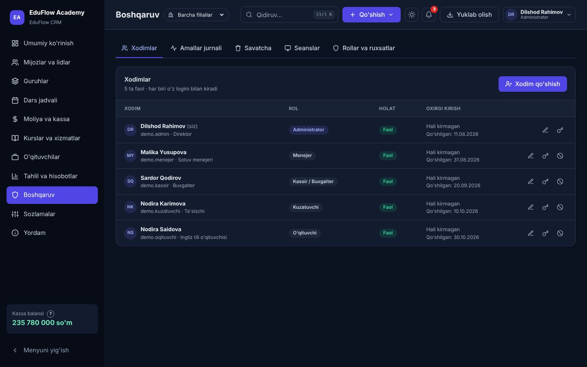 |
| 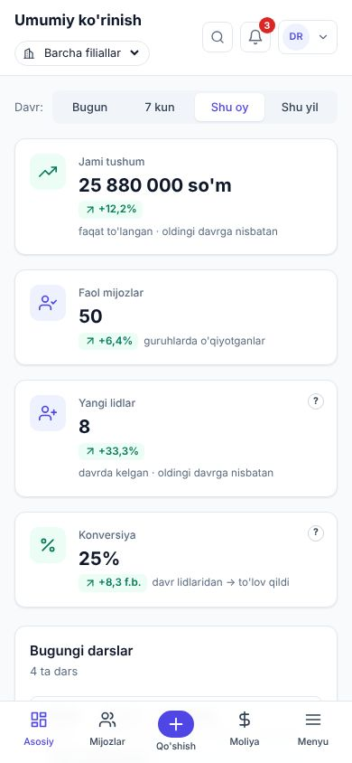 | 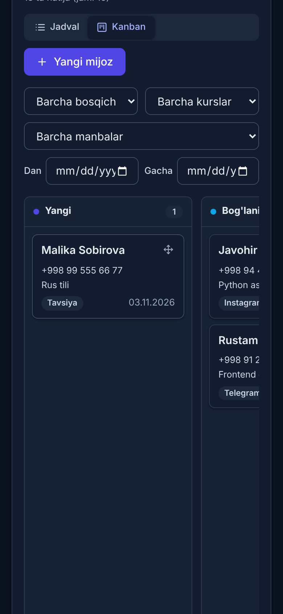 |

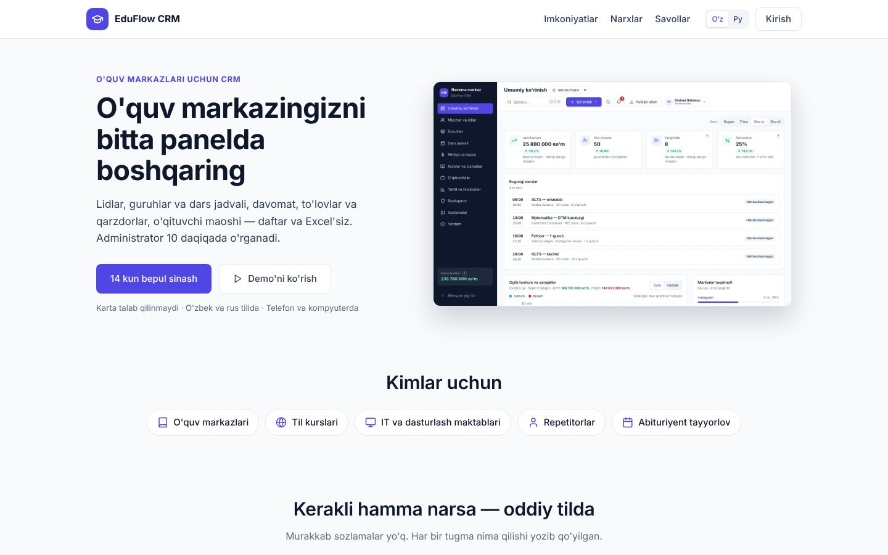

> Skrinshotlar demo ma'lumot bilan production build'dan (`npm run preview`) olingan.

---

## Mahsulot imkoniyatlari (oddiy foydalanuvchi uchun)

- **Sozlash ustasi** (markaz nomi, kurslar, administrator), qisqa **tanishtiruv** va "Boshlash ro'yxati"; har bo'limda
  bo'sh holat izohi va birinchi qadam tugmasi; **Yordam** bo'limi (savol-javob, qo'llab-quvvatlash kontaktlari).
- Telefonda **pastki menyu** va katta "Qo'shish" tugmasi; murakkab atamalar yonida oddiy izoh (masalan, "Konversiya — 10
  lidan nechtasi to'lov qildi").
- Har o'chirishdan oldin tasdiqlash, o'chirilgan narsa **30 kun savatchada**, toast'da **"Bekor qilish"**.
- **To'lov cheki** (80 mm termoprinter va A4) va mijoz kartasini chop etish.
- Formalar: telefon maskasi, takroriy raqamni ogohlantirish, tugallanmagan forma qoralama sifatida saqlanadi.
- Internet uzilsa — ogohlantirish chizig'i; yangi versiya bo'lagi yuklanmasa — qayta urinish va tushunarli xabar.

## Xodimlar, rollar va tariflar

| Rol | Nima qila oladi |
| --- | --- |
| Administrator | Hamma narsa: xodimlar, sozlamalar, zaxira, jurnal, savatcha |
| Menejer | Mijozlar va lidlar, to'lov qabul qilish |
| Kassir / Buxgalter | To'lovlar, xarajatlar, tahlil, hisobot yuklab olish |
| Kuzatuvchi | Faqat ko'rish |

Ruxsatlar jadvali bitta joyda — `src/auth/permissions.ts` (bulutda xuddi shu jadval `has_permission()` SQL funksiyasida).
Xodimga vaqtinchalik parol beriladi, birinchi kirishda o'zgartirish majburiy. **Amallar jurnali**: kim, qachon, nimani
o'zgartirdi. Faol seanslar ro'yxati va "Boshqa qurilmalardan chiqarish".

| Tarif | Narx (namuna) | Xodimlar |
| --- | --- | --- |
| Sinov | 14 kun bepul | 3 tagacha |
| Standart | 199 000 so'm / oy | 5 tagacha |
| Pro | 399 000 so'm / oy | cheksiz |

Narxlar `src/constants/plans.ts` da — **sotuvdan oldin haqiqiy narxlarni yozing**. Lokal rejimda tarif faqat ma'lumot uchun;
bulutli rejimda muddat tugasa yoki markaz to'xtatilsa ilova **faqat o'qish** rejimiga o'tadi (ma'lumot o'chmaydi).

## Bo'limlar

Bo'limlar (sidebar tartibida): **Umumiy ko'rinish · Mijozlar va lidlar · Moliya va kassa · Kurslar va xizmatlar ·
Tahlil va hisobotlar · Sozlamalar**. Barcha hisob-kitoblar Header'dagi umumiy davr tanlovi (Bugun / 7 kun / Shu oy / Shu yil)
bilan sinxron.

**Layout**

- Sidebar yig'iladi: to'liq (ikonka + nom) va ixcham (faqat ikonka, nom tooltip'da) — holat saqlanadi; mobilda chiqib keladigan menyu
- Header: global qidiruv (`Ctrl/Cmd + K`), bildirishnomalar, bitta tugmali yorug'/qorong'i mavzu, profil menyusi (ism, rol, Profil, Chiqish).
  Qidiruv Mijozlar / Moliya / Kurslar'da ro'yxatni filtrlaydi; boshqa bo'limlarda natijalar oynasi chiqadi (mijozlar, kurslar,
  tranzaksiyalar — strelkalar va Enter bilan)

**Umumiy ko'rinish**

- 4 ta KPI: Jami tushum, Faol mijozlar ("To'lov qildi"), Yangi lidlar (davrda kelganlar), Konversiya — oldingi teng davrga nisbatan trend
- Oylik tushum va xarajatlar grafigi (qo'lda yozilgan SVG, oylik / haftalik, klaviatura bilan), manbalar taqsimoti,
  so'nggi amallar lentasi (bosqich va to'lov statusi bilan), tezkor amallar

**Mijozlar va lidlar — sotuv voronkasi**

- Bosqichlar: **Yangi → Bog'lanildi → O'ylayapti → To'lov qildi → Bekor qilindi**
- Ikki ko'rinish (tanlov saqlanadi): **Jadval** (saralash, sahifalash, bosqichni jadvalning o'zida almashtirish) va
  **Kanban** (ustun sarlavhasida mijozlar soni; kartani sichqoncha bilan sudrab o'tkazish; klaviaturada — kartadagi
  bosqich menyusi yoki `Alt + ←/→`, `Enter` — kartani ochish). Mobilda Kanban faqat o'z ichida gorizontal aylanadi
- Yangi mijoz: Ism, Telefon (`+998 XX XXX XX XX` maskasi, takroriy raqam taqiqlanadi), Manba, Kurs/Xizmat, Izoh
- Qidiruv va filtrlar: bosqich, manba, kurs, qo'shilgan sana oralig'i
- Mijoz kartasi: bosqichni shu yerning o'zida o'zgartirish, guruhlari (har biri bo'yicha qarz yoki avans, davomat),
  oxirgi 12 oy jadvali (kutilgan / to'langan / balans), to'lovlar tarixi (statuslari bilan), jami to'langan;
  tahrirlash, tasdiqlash bilan o'chirish (to'lovlar jurnalda "Ism (o'chirilgan)" ko'rinishida qoladi).
  Guruhga yozilmagan mijozda — eskicha: "To'lov qildi" sanasi, o'qish oyi ("2-oy / 6") va joriy oy qarzi

**Moliya va kassa**

- Yuqorida: umumiy balans (kassa), jami kirim, jami chiqim (tanlangan davr)
- To'lovlar jadvali: Sana, Mijoz, Summa, To'lov turi (Naqd / Karta / O'tkazma), Status (To'langan / Kutilmoqda /
  Bekor qilingan — jadvalning o'zida almashtiriladi). **Balans va barcha KPI faqat "To'langan" bo'yicha hisoblanadi**
- Kirim / Chiqim formasi; marketing chiqimiga ixtiyoriy **Manba** (CPL/ROI uchun). "Kutilmoqda" to'lov kelajakdagi sana bilan
  kiritiladi; "To'landi" deb belgilanganda to'lov sanasi bugun bo'ladi
- To'lov formasi: o'quvchi tanlangach **guruh** (o'qish) va **qaysi oy uchun** tanlanadi, summa shu guruh bo'yicha tanlangan oy
  oxirigacha qoldiq bilan o'zi to'ldiriladi; chekda guruh va oy ko'rsatiladi
- **Qarzdorliklar va kutilayotgan to'lovlar**: qarzi kattasidan saralangan ro'yxat (Mijoz, Guruh, Oylik, Qarz), qatordan
  "To'lov qabul qilish" (qarzi eng katta guruh va muddati o'tgan oxirgi oy oldindan tanlanadi); "Kutilmoqda" to'lovlarni bir
  bosishda "To'landi" deb belgilash
- **To'lov eslatmasi**: qatordagi "Eslatma" — Sozlamalardagi shablon bo'yicha tayyor matn (o'zbekcha yoki ruscha):
  nusxa olish, Telegram'da ulashish, SMS, qo'ng'iroq. Bir nechtasini belgilab — hammasi bitta nusxada. Yuborilgan eslatma
  jurnalga yoziladi, ro'yxatda "Oxirgi eslatma: N kun oldin" ko'rinadi. Shablon o'zgaruvchilari:
  `{ism} {summa} {kurs} {guruh} {oy} {markaz} {telefon}`
- To'lov turlari va xarajatlar tarkibi bo'yicha taqsimot

**Kurslar va xizmatlar**

- Nom, turi (kurs / xizmat), davomiyligi (oy), oylik narxi, faol guruhlar soni, holati (faol / arxiv)
- Har bir kursda talabalar soni ("To'lov qildi"), jami lidlar, oylik kutilayotgan tushum (talabalar × narx)
- Qo'shish, tahrirlash (nom o'zgarsa mijozlardagi kurs nomi ham yangilanadi), arxivlash/qaytarish; mijozi bor kurs
  o'chirilmaydi — arxivlanadi

**Tahlil va hisobotlar**

- O'rtacha chek (AOV), to'langan kirim, marketing chiqimi (umumiy CPL bilan), konversiya
- Sotuv voronkasi (davr lidlari hozir qaysi bosqichda) va kurslar bo'yicha tushum
- Manbalar samaradorligi: lidlar, "To'lov qildi", konversiya, marketing chiqimi, CPL, ROI (Jami qatori bilan)
- CSV va Excel eksport: mijozlar, tranzaksiyalar, qarzdorlar, manbalar hisoboti (CSV injection himoyasi bilan)

**Sozlamalar**

- Tashkilot: nom, logotip (rasm, 200 KB gacha; yo'q bo'lsa harfli logo), telefon, manzil
- Mintaqa va ko'rinish: asosiy valyuta (UZS / USD), sana formati, CSV ajratgich, mavzu (yorug' / qorong'i / tizim)
- Profil va xavfsizlik: to'liq ism, rol/lavozim, login va parolni almashtirish
- Ma'lumotlar: JSON zaxira, zaxiradan tiklash, demo ma'lumot, tasdiqlash bilan **barcha ma'lumotni tozalash (Reset)**,
  taxminiy band joy (KB va ~5 MB ga nisbatan %)

**Umumiy**

- Demo markaz alohida xotirada: undan chiqilganda sizning ma'lumotingiz o'z joyida qoladi
- Saqlash xatosi (xotira to'lgan) haqida aniq ogohlantirish; bir nechta tab orasida sinxronlash
- Bildirishnomalar: bog'lanilmagan yangi lidlar, qarzdorlar, chiqim kirimdan oshishi, manfiy balans
- Parol PBKDF2-HMAC-SHA256 (210 000 iteratsiya); noto'g'ri urinishlarda o'sib boruvchi blok
- Yorug' / qorong'i / tizim mavzusi, ranglar faqat CSS o'zgaruvchilaridan, WCAG AA kontrast (ikkala mavzuda tekshirilgan)
- Responsiv: 1440 / 1024 / 768 / 390 px; mobilda jadvallar kartalarga aylanadi, sahifada gorizontal scroll yo'q
- Klaviatura: `Ctrl/Cmd + K` — qidiruv, `N` — yangi mijoz, fokus tuzog'i, skip link

## Hisob qoidalari va formulalar

Barcha formulalar sof funksiyalar va testlar bilan: `src/utils/analytics.ts`, `src/utils/debts.ts`, `src/utils/courses.ts`, `src/utils/search.ts`.

| Ko'rsatkich | Formula |
| --- | --- |
| Kassa balansi | barcha vaqtdagi "To'langan" kirim − "To'langan" chiqim |
| Jami tushum | davrdagi "To'langan" kirimlar |
| Faol mijozlar | "To'lov qildi" bosqichidagi mijozlar, davr oxiri holati — shu bosqichga o'tgan sana (`paidAt`) bo'yicha |
| Yangi lidlar | davrda qo'shilgan mijozlar (istalgan bosqichda) |
| Konversiya | davrda kelgan lidlardan "To'lov qildi" bosqichidagilar ulushi; trend — foiz bandida |
| O'rtacha chek (AOV) | davrdagi "To'langan" kirimlar summasi / ular soni |
| CPL | manba bo'yicha "To'langan" marketing chiqimi / davrda shu manbadan kelgan lidlar (umumiy CPL — barcha marketing chiqimi / barcha lidlar) |
| ROI | (shu manbadan kelgan mijozlarning davrdagi kirimi − chiqim) / chiqim × 100 |
| Kurs: kutilayotgan tushum | "To'lov qildi" talabalar soni × oylik narx |

Chiqim (yoki lid) 0 bo'lsa CPL va ROI **"—"** ko'rsatiladi — nolga bo'linmaydi. "Jami" qatori o'rtachalardan emas, yig'indilardan
qayta hisoblanadi.

**Qarzdorlik** (`src/utils/debts.ts`, v11 — har bir o'qish, ya'ni o'quvchining guruhga yozilishi bo'yicha alohida hisob):

1. **Oylik summa** = (individual narx ?? kurs narxi) × (1 − chegirma %).
2. **Oylar**: o'qish boshlangan oydan joriy oygacha; tugash (ketish) sanasidan keyingi oylar hisoblanmaydi.
   **Pauza** oralig'iga to'g'ri kelgan kunlar hisoblanmaydi: butun oy pauzada — 0, qisman — faol kunlar ulushida.
3. **Birinchi oy**: Sozlamalarda "Birinchi oyni kunlar bo'yicha hisoblash" yoqilgan bo'lsa — boshlangan kundan oy oxirigacha
   ulushda, aks holda to'liq.
4. **To'lov muddati**: har oyning N-sanasi (Sozlamalar → O'quv jarayoni, standart 10); birinchi oy — o'qish boshlangan kun.
   Muddati o'tmagan oy hali qarz emas.
5. **To'langan** = shu o'qishga tegishli **"To'langan"** kirimlar (quyidagi "Kirim qaysi guruhga tegishli" qoidasi).
   "Kutilmoqda" va "Bekor qilingan" kirmaydi.
6. **Balans** = Σ to'langan − Σ muddati o'tgan oylar summasi (o'qish boshidan). Manfiy — qarz, musbat — **avans**: ortiqcha
   to'lov keyingi oylarga o'tadi. Mijozning qarzi — barcha o'qishlari balansining yig'indisi.
7. **Guruhga yozilmagan** "To'lov qildi" mijozlar — eskicha: joriy oy uchun kurs narxi − shu oy to'langan
   (kurs davomiyligi tugagan bo'lsa qarz yo'q).
8. Ro'yxat qarzi kattasidan saralanadi; "Kutilmoqda" to'lovlar alohida ro'yxatda.

To'lov formasidagi summa = tanlangan o'qish bo'yicha tanlangan oy oxirigacha Σ kutilgan − Σ to'langan (muddatidan qat'i nazar).
Mijoz kartasidagi oylar jadvalida to'lov "qaysi oy uchun" (`period`) bo'lsa o'sha oyga, bo'lmasa to'lov oyiga yoziladi.

**Kirim qaysi guruhga tegishli** (`src/utils/attribution.ts` — maosh va guruh bo'yicha qarz uchun yagona qoida):

| Holat | Kirim qayerga hisoblanadi |
| --- | --- |
| Tranzaksiyada `enrollmentId` bor | O'sha o'qish (guruh) |
| `enrollmentId` yo'q | To'lov sanasida o'quvchining shu kurs (`Customer.course`) bo'yicha faol o'qishi; bir nechta bo'lsa — eng oldin boshlangani |
| Bunday o'qish topilmadi | Hech bir guruhga ham, maoshga ham hisoblanmaydi |

**O'qituvchi maoshi (oy bo'yicha, `src/utils/payroll.ts`):**

| Ko'rsatkich | Formula |
| --- | --- |
| Yig'ilgan kirim | oy ichidagi "To'langan" kirimlar, yuqoridagi qoida bo'yicha o'qituvchi guruhlariga tegishlilari |
| Faol o'quvchilar | o'qituvchi guruhlarida oy ichida kamida bir kun faol (butun oy pauzada emas) bo'lgan o'quvchilar, har biri bir marta |
| Hisoblangan maosh | `fixed` — belgilangan summa; `percent` — yig'ilgan kirim × foiz; `perStudent` — faol o'quvchilar × summa |
| To'langan | shu o'qituvchiga (`teacherId`) shu oy uchun (`period`, bo'lmasa xarajat sanasining oyi) "To'langan" maosh xarajatlari |
| Qolgan | max(0, hisoblangan − to'langan) |

"Maosh to'lash" (`payroll.manage`) kassadan `salary` kategoriyasida, `teacherId` va `period` bilan xarajat yozadi; xarajat sanasi —
to'langan kun. Oy o'rtasida guruh almashgan o'quvchining kirimi to'lov sanasidagi guruhga, chegirmali o'quvchida — haqiqatda
to'langan summa bo'yicha hisoblanadi (testlar: `src/utils/payroll.test.ts`).

## Texnologiyalar

React 19 · TypeScript 7 · Vite 8 · React Compiler · Vitest · Testing Library · Playwright. Runtime bog'liqliklar: `react`, `react-dom` va
`@supabase/supabase-js` (alohida bo'lak, faqat bulutli rejimda yuklanadi) — router, UI, grafik yoki sana kutubxonalari ishlatilmagan. Stillar toza CSS (CSS variables), grafiklar qo'lda yozilgan SVG.

## O'rnatish va ishga tushirish

Talab: **Node.js 20.19+** (tavsiya: 22, `.nvmrc` da ko'rsatilgan).

```bash
npm install
npm run dev
```

`http://localhost:5173/` — landing, `http://localhost:5173/app` — ilova. Muhit o'zgaruvchilari (hammasi ixtiyoriy) —
`.env.example` da: Supabase kalitlari, `VITE_SITE_URL`, qo'llab-quvvatlash kontaktlari (`VITE_SUPPORT_TELEGRAM`,
`VITE_SUPPORT_PHONE`, `VITE_SUPPORT_EMAIL`), sotuvchi paneli paroli xeshi, demo-sayt rejimi.

Ketma-ket 5 ta noto'g'ri parol urinishidan keyin kirish bloklanadi: 30 s → 60 s → 120 s → … (eng ko'pi 15 daqiqa),
24 soatdan keyin hisoblagich nolga tushadi.

## Scriptlar

| Buyruq | Vazifasi |
| --- | --- |
| `npm run dev` | Ishlab chiqish serveri |
| `npm run build` | Tur tekshiruvi va production build (`dist/`), so'ng `scripts/spa-routes.mjs` (sahifa nusxalari, sitemap) |
| `npm run build:pages` | Namoyish sayti build'i (`site/`, `/eduflow-crm/` ostida, 404.html va .nojekyll bilan) |
| `npm run preview` | Build natijasini lokal ko'rish (prod CSP sarlavhasi bilan) |
| `npm run lint` | Oxlint (ogohlantirishlar ham xato hisoblanadi) |
| `npm run test` / `test:watch` | Vitest: unit va komponent testlari |
| `npm run typecheck` | Faqat TypeScript tekshiruvi |
| `npm run check` | typecheck + lint + test + build — deploydan oldin |
| `npm run e2e` | Playwright e2e (avval `npm run build`; brauzer: `npx playwright install chromium`) |
| `npm run owner:password "parol"` | Lokal/demo rejimdagi `/owner` paroli uchun `VITE_OWNER_PASSWORD_HASH` |

## Papkalar tuzilishi

```
src/
├── auth/            Rollar va ruxsatlar jadvali
├── components/      Bo'limlar: overview, customers, finance, courses, analytics, settings, admin (xodimlar, jurnal,
│                    savatcha), auth, onboarding, help, print (chek), layout, ui (umumiy komponentlar)
├── constants/       Ilova nomi, navigatsiya, ikonlar, tariflar, demo ma'lumot
├── context/         Dashboard, Auth (lokal va bulutli), Theme provayderlari
├── data/            Supabase adapteri: ulanish, mapper'lar, o'zgarishlar farqi (diff), sinxronlash
├── hooks/           useAuth, useToast, useConfirm, useOnline, useNotifications ...
├── i18n/            tr(), til almashtirish, rus lug'ati
├── landing/         Landing va huquqiy sahifalar
├── owner/           Sotuvchi paneli (/owner)
├── services/        storage (versiya, migratsiya), auth (PBKDF2), users, sessions, audit, trash, subscription, export
├── utils/           analytics, debts, courses, format, phone, lazyRetry ...
├── router.ts        Sahifa marshrutlari (/, /app, /owner, /privacy, /terms)
└── index.css        Dizayn tokenlari (yorug'/qorong'i) va stillar
supabase/            Migratsiya (sxema + RLS), seed, staff funksiyasi, RLS testlari
e2e/                 Playwright testlari
```

## Tillar

O'zbek (lotin) — asosiy, rus — `src/i18n/ru.ts` (kalit — o'zbekcha matn, lug'at alohida bo'lakda faqat rus tili tanlanganda
yuklanadi). Til Sozlamalar → Ko'rinish'da yoki landing'da almashtiriladi va `apex:lang` da saqlanadi. Yangi matn qo'shsangiz
`tr('...')` bilan o'rang: `src/i18n/i18n.test.ts` lug'atda tarjimasi yo'q matnni topib, testni yiqitadi.

## Sifat: testlar va Lighthouse

- **Unit va komponent testlari** (Vitest + Testing Library): 388 ta test — `npm run test`.
- **E2E** (Playwright, `e2e/`): landing, demo, ro'yxatdan o'tish → mijoz → to'lov → chek, xodim qo'shish; desktop va
  Pixel 7 (mobil) da, konsolda xato yo'qligi va gorizontal scroll yo'qligi tekshiriladi — `npm run e2e`.
- **RLS testlari** oddiy PostgreSQL'da (`supabase/tests/run-local.sh`): bir markaz boshqasining ma'lumotini ko'rmaydi,
  rollar, savatcha, faqat o'qish rejimi.
- CI (`.github/workflows/ci.yml`) har push va PR'da uchalasini ham bajaradi.

**Lighthouse (mobil, production build):**

| Sahifa | Performance | Accessibility | Best Practices | SEO |
| --- | --- | --- | --- | --- |
| `/` (landing) | 98 | 100 | 100 | 100 |
| `/app` | 95 | 100 | 100 | 100 |
| `/privacy` | 99 | 100 | 100 | 100 |

## Ma'lumotlar qayerda saqlanadi

Ikki rejim bor:

- **Lokal** (Supabase kalitlari berilmagan): hamma ma'lumot shu brauzerning `localStorage`'ida.
- **Bulutli** (Supabase): ma'lumot serverda, markazlar RLS bilan ajratilgan — pastdagi "Bulutli rejim" bo'limi.

Lokal rejim kalitlari (`apex:` prefiksi eski versiyalar ma'lumoti yo'qolmasligi uchun o'zgartirilmaydi; demo markaz
xuddi shu kalitlarni `eduflow-demo:` prefiksi ostida alohida saqlaydi):

| Kalit | Tarkibi |
| --- | --- |
| `apex:customers`, `apex:transactions`, `apex:courses`, `apex:settings` | Asosiy ma'lumotlar |
| `apex:version` | Sxema versiyasi (hozir **10**) |
| `apex:users`, `apex:auth`, `apex:sessions`, `apex:login-lock` | Xodimlar, parol xeshlari (PBKDF2-SHA256), seanslar, kirish bloki |
| `apex:audit`, `apex:trash` | Amallar jurnali, savatcha (30 kun) |
| `apex:subscription` | Tarif va sinov muddati |
| `apex:seeded`, `apex:demo`, `apex:tour` | Birinchi sozlash, demo, tanishtiruv holati |
| `apex:theme`, `apex:lang`, `apex:notifications`, `apex:sidebar-collapsed`, `apex:customers-view` | Ko'rinish va qulayliklar |
| `apex:session` (sessionStorage) | Joriy seans — tab yopilganda tugaydi |

### Sxema versiyalari va migratsiyalar

Migratsiyalar yozuv shakliga qarab ishlaydi (`normalizeData`): istalgan eski versiyadagi `localStorage` ham, eski JSON zaxira
ham joriy sxemaga ko'chiriladi, buzuq yozuvlar tashlab yuboriladi va soni ko'rsatiladi. Yangiroq versiyadagi zaxira rad etiladi.

| Versiya | O'zgarish | Eski → yangi |
| --- | --- | --- |
| v2 | Tranzaksiya kategoriyasi | izoh va turiga qarab taxmin |
| v3 | Tranzaksiyada mijoz ismi snapshot'i | mavjud mijozlar ismi ko'chiriladi |
| v4 | Profil: `profileName`, `profileRole` | `''`, `Administrator` |
| v5 | Mijoz holati → voronka bosqichi | `lead → new`, `active → paid`, `paused → thinking`, `left → cancelled` |
| v6 | Kurslar alohida entity (`apex:courses`) | `settings.courses` va mijozlardagi nomlar → kurs (narx 0, 1 oy, 0 guruh, faol) |
| v7 | To'lov turi, status, marketing manbasi | `payme, click → card`, `bank → transfer`, `cash → cash`; status → `paid` |
| v8 | Logotip rasmi `settings.logoImage` | `''` (harfli logo) |
| v9 | "To'lov qildi" sanasi `customer.paidAt` | birinchi to'langan kirim sanasi, bo'lmasa qo'shilgan sana |
| v10 | Kurs davomiyligi 0 — "muddatsiz" | v6 yaratgan (1 oy, narx 0, 0 guruh) kurslar → muddatsiz |

Lokal rejimda boshqa brauzer yoki qurilmada ma'lumotlar ko'rinmaydi — ko'chirish uchun
**Sozlamalar → Ma'lumotlar → JSON zaxira** dan foydalaning. Brauzer tarixini tozalash ma'lumotlarni ham o'chiradi, shuning uchun
zaxirani muntazam yuklab oling.

## Bulutli rejim (Supabase)

Kalitlarsiz ilova **lokal rejimda** ishlaydi: ma'lumot shu brauzerda, "Demo'ni ko'rish" — alohida namunaviy markaz.
`VITE_SUPABASE_URL` va `VITE_SUPABASE_ANON_KEY` berilsa — **bulutli rejim**: email + parol bilan kirish, ma'lumot serverda,
har markaz RLS bilan ajratilgan, istalgan qurilmadan ishlash, tarif muddati va to'xtatish majburiy.

### Ulash — qadam-baqadam

1. **Loyiha yarating.** [supabase.com](https://supabase.com) → *New project*. Region tanlang (pastdagi "Ma'lumot joylashuvi"ga qarang),
   kuchli DB parolini saqlab qo'ying.
2. **Sxemani o'rnating.** Kompyuterda [Supabase CLI](https://supabase.com/docs/guides/cli) o'rnatilgan bo'lsin:
   ```bash
   supabase login
   supabase link --project-ref <loyiha-id>
   supabase db push
   ```
   CLI'siz: Dashboard → *SQL Editor* → `supabase/migrations/20261106000001_init.sql` mazmunini qo'yib *Run*.
3. **Xodim funksiyasini joylang** (xodim qo'shish va parolini tiklash — service role kaliti faqat serverda qoladi):
   ```bash
   supabase functions deploy staff
   ```
4. **Auth sozlamalari.** Dashboard → *Authentication → URL Configuration*: *Site URL* = `https://<domeningiz>/app`,
   *Redirect URLs* ga ham shu manzilni qo'shing (parolni tiklash havolasi shu yerga qaytaradi).
   *Providers → Email*: yoqilgan. "Confirm email" yoqilgan bo'lsa, ro'yxatdan o'tgan markaz emailni tasdiqlagach yaratiladi.
5. **Kalitlarni ilovaga bering.** Dashboard → *Project Settings → API*: `Project URL` va `anon public` kalit.
   Vercel → *Settings → Environment Variables*:
   ```
   VITE_SUPABASE_URL=https://<loyiha-id>.supabase.co
   VITE_SUPABASE_ANON_KEY=<anon kalit>
   ```
   Lokal: `.env.example` dan `.env.local` yarating. **`service_role` kalitini hech qachon ilovaga yozmang.**
6. **Qayta deploy qiling** va `/app` da "Ro'yxatdan o'tish" — markaz 14 kunlik sinov bilan yaratiladi.
7. **Sotuvchi (super-admin).** O'zingiz `/app` da ro'yxatdan o'ting (yoki Dashboard → *Authentication → Add user*), so'ng
   *SQL Editor* da:
   ```sql
   insert into public.platform_admins (user_id) select id from auth.users where email = 'siz@domen.uz';
   ```
   Endi `/owner` da shu email bilan kirasiz: markazlar, tarif, +30 kun, to'xtatish.
8. **Savatchani avtomatik tozalash** (30 kundan eski o'chirilganlar). Dashboard → *Database → Extensions* → `pg_cron`, so'ng:
   ```sql
   select cron.schedule('eduflow-purge-trash', '15 3 * * *', $$select public.purge_trash()$$);
   ```
9. **Eski ma'lumotni ko'chirish.** Avval lokal rejimda ishlagan markaz shu brauzerda bulutli rejimga kirsa, Sozlamalar →
   Ma'lumotlar'da **"Bulutga ko'chirish"** chiqadi (mijozlar, to'lovlar, kurslar, sozlamalar). Boshqa kompyuterdagi ma'lumot —
   o'sha yerda JSON zaxira olib, bulutda Sozlamalar → Ma'lumotlar → "Zaxirani tiklash".

### Nima qayerda

| Narsa | Joyi |
| --- | --- |
| Jadvallar, RLS, RPC, triggerlar | `supabase/migrations/20261106000001_init.sql` |
| Lokal Supabase uchun namunaviy markaz | `supabase/seed.sql` (`supabase start` → demo@eduflow.uz / DemoParol2026) |
| Xodim qo'shish / parol tiklash | `supabase/functions/staff/index.ts` |
| RLS testlari (oddiy PostgreSQL'da) | `supabase/tests/run-local.sh` |
| Ilovadagi adapter | `src/data/` (`supabase.ts`, `mappers.ts`, `diff.ts`), `src/context/CloudAuthProvider.tsx` |

- Ruxsatlar `has_permission()` da — `src/auth/permissions.ts` dagi jadval bilan bir xil; birini o'zgartirsangiz, ikkinchisini ham.
- Markaz o'z tarifini, holatini va muddatini o'zgartira olmaydi (ustun huquqlari); buni faqat sotuvchi `owner_update_org` bilan qiladi.
- Muddat tugasa yoki markaz to'xtatilsa — RLS faqat o'qishga ruxsat beradi, ma'lumot o'chmaydi.
- O'chirish — `deleted_at` (savatcha, `trash_move` / `trash_restore`), butunlay o'chirish — faqat savatchadan.
- Amallar jurnali (`audit_log`) server triggerlari bilan yoziladi; ilova faqat kirish, eksport va zaxira hodisalarini yuboradi.

### Ma'lumot joylashuvi (muhim)

O'zbekiston qonunchiligiga ko'ra fuqarolarning shaxsga doir ma'lumotlari O'zbekiston hududidagi serverlarda saqlanishi kerak.
Supabase'ning bunday regioni yo'q. Bulutli rejimni mijozlarga sotishdan oldin **yurist bilan maslahatlashing**: muqobil — Supabase'ni
(ochiq kodli) O'zbekistondagi serverda o'zingiz joylashtirish (self-hosted), sxema va ilova o'zgarishsiz ishlaydi.

## Deploy

### Vercel (asosiy sayt)

1. [vercel.com](https://vercel.com) → **Add New → Project** → shu repozitoriyni import qiling, *Production Branch* — `main`.
2. Sozlamalar `vercel.json` dan olinadi (build, `dist`, SPA rewrite, kesh va xavfsizlik headerlari).
3. Bulutli rejim uchun *Settings → Environment Variables* ga `VITE_SUPABASE_URL` va `VITE_SUPABASE_ANON_KEY` qo'shing
   (pastdagi "Bulutli rejim"). Domen ulasangiz `VITE_SITE_URL` ni ham bering.

### GitHub Pages (faqat demo)

`.github/workflows/pages.yml` `main` ga har push'da `npm run check` dan so'ng `npm run build:pages` (`--base /eduflow-crm/`,
`VITE_DEMO_ONLY=1`) bilan yig'ib `gh-pages` branch'iga joylaydi. Repozitoriya *Settings → Pages*: manba — `gh-pages` branch.
*Settings → Secrets and variables → Actions → Variables*: `MAIN_SITE_URL` (Vercel manzili) — "Bepul sinash" va tariflar
shu saytning `/app` sahifasiga olib boradi; `SUPPORT_TELEGRAM`, `SUPPORT_PHONE`, `SUPPORT_EMAIL` — footer, Yordam va
"Ulanish uchun ariza". Hech biri berilmasa workflow `::warning::` chiqaradi va landing'da faqat demo qoladi (berk ko'cha yo'q).

**Deep link'lar.** `scripts/spa-routes.mjs` build'dan keyin `app/`, `privacy/`, `terms/`, `owner/` papkalariga `index.html`
nusxasini (o'z `<title>`, `canonical`, `og:url`; `/app` va `/owner` da `noindex`) va `sitemap.xml` ni yozadi — shuning uchun
`/eduflow-crm/app` ham **200** qaytaradi (ilgari `404.html` orqali 404 status bilan ochilardi). `npm run build` ham shu skriptni
ishga tushiradi. E2E `e2e/pages.spec.ts` Pages'ni taqlid qiluvchi serverda (`scripts/pages-server.mjs`) buni tekshiradi.

> Pages sayti pastki papkada (`/eduflow-crm/`) — **`robots.txt` u yerda ishlamaydi** (qidiruv tizimlari uni faqat domen
> ildizidan o'qiydi). Indekslanmasligi kerak bo'lgan sahifalarda `<meta name="robots" content="noindex">` bor. Vercel'dagi
> asosiy saytda `robots.txt` ildizda va `Sitemap:` qatori bilan ishlaydi.

### Netlify (ixtiyoriy)

`netlify.toml` tayyor (Node 22, `dist`, SPA redirect, headerlar).

`og:url`, `canonical` va to'liq `og:image` build paytida qo'shiladi: Vercel'da avtomatik, boshqa joyda `VITE_SITE_URL` bering.

> Parol xeshi Web Crypto API orqali hisoblanadi — faqat **HTTPS** yoki `localhost` da ishlaydi.

### Xavfsizlik sarlavhalari

`vercel.json` va `netlify.toml` bir xil `Content-Security-Policy` yuboradi:

```
default-src 'self'; script-src 'self'; style-src 'self' 'unsafe-inline'; img-src 'self' data: blob:;
font-src 'self'; connect-src 'self' https://*.supabase.co wss://*.supabase.co; object-src 'none'; base-uri 'self';
form-action 'self'; frame-ancestors 'none'
```

- Inline skript yo'q: mavzuni oldindan qo'llovchi skript `public/theme-init.js` faylida, shuning uchun hash kerak emas.
- `'unsafe-inline'` faqat stillar uchun (React `style` atributlari: grafik va progress kengliklari).
- `npm run preview` ham shu CSP'ni yuboradi (`vite.config.ts` uni `vercel.json` dan o'qiydi) — build'ni brauzer
  konsolida CSP xatolari yo'qligiga tekshirish mumkin. CSP o'zgartirilsa, ikkala faylni yangilang: test farqni ushlaydi.
- Qo'shimcha: `X-Frame-Options: DENY`, `X-Content-Type-Options: nosniff`, `Referrer-Policy`, `Permissions-Policy`.

## Xavfsizlik: lokal rejim cheklovlari

Lokal rejimda (Supabase'siz) kirish — **tasodifiy foydalanuvchidan himoya, maxfiylik emas**: ma'lumot `localStorage`'da
shifrlanmagan, kompyuterga kira oladigan odam DevTools orqali uni o'qiy yoki o'zgartira oladi, kirish va rollar brauzerda
tekshiriladi, JSON zaxira ham shifrlanmagan. PBKDF2 faqat parolning o'zini himoya qiladi.

Haqiqiy himoya — **bulutli rejim**: autentifikatsiya Supabase Auth'da, har markaz ma'lumoti RLS bilan ajratilgan, rollar va
faqat-o'qish rejimi serverda tekshiriladi, jurnal server triggerlari bilan yoziladi. Pullik mijozlarga bulutli rejimni bering.

## Cheklovlar

- Lokal rejimda ma'lumotlar bitta brauzerga bog'langan. `localStorage` hajmi taxminan 5 MB bilan cheklangan
  (aniq limit brauzerga bog'liq, band joy ko'rsatkichi taxminiy). Xotira to'lsa, yangi o'zgarishlar faqat ochiq tabda qoladi —
  ogohlantirish chiqqanda darhol JSON zaxira oling.
- Valyutani USD ga o'zgartirish faqat belgini almashtiradi — summalar konvertatsiya qilinmaydi.
- To'liq bosqich tarixi saqlanmaydi — faqat "To'lov qildi" ga o'tgan sana (`paidAt`). Bosqichdan chiqqan mijoz oldingi
  davrlar "Faol mijozlar" sonidan ham tushib qoladi; konversiya lidning joriy bosqichi bo'yicha.
- Qarz "oylik to'lov" modelida: bir martalik (butun kurs uchun) to'lov va kurs davomiyligi bo'yicha avtomatik tugash yo'q —
  o'quvchi guruhdan chiqarilganda (tugash sanasi) hisob to'xtaydi. Guruhga yozilmagan mijozlar uchun eskicha (faqat joriy oy)
  hisob qoladi; mijoz kursga nom orqali bog'langan.
- Eslatmalar avtomatik yuborilmaydi: matn tayyorlanadi, yuborish — nusxa, Telegram yoki SMS ilovasi orqali qo'lda.
- Sana maydonlari brauzerning tili/hududiga qarab ko'rinadi (masalan, `mm/dd/yyyy` yoki `dd.mm.yyyy`).
- Logotip `localStorage`'da data URL sifatida saqlanadi (200 KB gacha) — band joyni oshiradi.
- CSV'da `=`, `+`, `-`, `@` bilan boshlangan matnlar (masalan, `+998...` telefonlar) Excel formula sifatida bajarilmasligi uchun
  `'` belgisi bilan boshlanadi. Telefonlar toza ko'rinishi kerak bo'lsa, Excel (.xls) eksportidan foydalaning.

## Keyingi rivojlanish

- Payme / Click: obuna to'lovini avtomatik qabul qilish va to'lovlarni avtomatik qayd etish
- SMS (Eskiz) va Telegram bot orqali avtomatik eslatmalar (to'lov muddati, dars jadvali), ota-onalar uchun bot
- O'zbekistondagi serverda (self-hosted Supabase) joylashtirish
