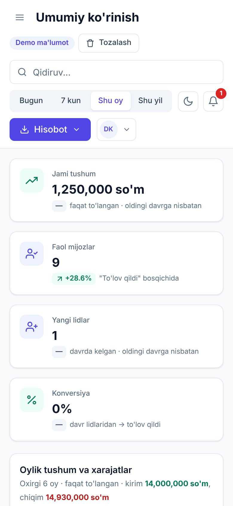

# EduFlow CRM

[](https://github.com/Ulugbek-Ar/eduflow-crm/actions/workflows/ci.yml) · versiya 1.0.0

**Ta'lim markazlari va kichik biznes uchun CRM boshqaruv paneli.** Mijozlar bazasi, to'lovlar, kassa balansi, hisobotlar va
analitika — bitta brauzer ilovasida. Interfeys to'liq o'zbek tilida (lotin), mobil qurilmalar va qorong'i mavzu qo'llab-quvvatlanadi.


| Qorong'i mavzu                                   | Mobil (390 px)                         |
| ------------------------------------------------ | -------------------------------------- |
|          |     |

> Skrinshotlar `docs/` papkasida. O'z brendingiz bilan yangilash uchun ularni almashtiring.

---

## Imkoniyatlar

**Umumiy ko'rinish**

- 4 ta KPI: tushum, yangi mijozlar, to'lov qilgan mijozlar, konversiya — oldingi teng davrga nisbatan trend bilan
- Kirim va chiqim grafigi: oylik / haftalik, tooltip, klaviatura bilan navigatsiya
- Mijozlar manbasi (soni, ulushi, konversiyasi), so'nggi faoliyat, tezkor amallar
- Barcha ko'rsatkichlar yuqoridagi davr tanlovi (Bugun / 7 kun / Shu oy / Shu yil) bilan sinxron

**Mijozlar**

- Qidiruv (ism, telefon, kurs, email), holat / kurs / manba filtrlari, saralash, sahifalash (10 / 20 / 50)
- Qo'shish va tahrirlash: `+998 XX XXX XX XX` maskasi, email tekshiruvi, takroriy telefon taqiqlanadi
- Holatni jadvalning o'zida almashtirish, mijoz kartasi (to'lovlar tarixi, jami to'lov)

**Moliya**

- Kirim / chiqim jurnali: tur, usul, kategoriya, sana oralig'i filtrlari, saralash, tahrirlash
- To'lov formasi: qidiruvli mijoz tanlash, minglik ajratgichli summa, Kirim / Chiqim kategoriyalari
- To'lov usullari va xarajatlar tarkibi bo'yicha taqsimot, kassa balansi

**Hisobotlar va ma'lumotlar**

- CSV (UTF-8 BOM, `;` yoki `,`) va Excel (.xls) eksport — joriy filtrlangan ro'yxatdan
- To'liq JSON zaxira va zaxiradan tiklash (oldindan ko'rish va tasdiqlash bilan)
- Sxema versiyasi va migratsiyalar, buzuq yozuvlarni avtomatik tashlab yuborish
- Bir nechta tab ochiq bo'lsa ma'lumotlar sinxronlanadi
- Brauzer xotirasi to'lsa yoki saqlash bloklansa — aniq ogohlantirish (bir xil xato uchun bir marta) va sahifadan
  chiqishda tasdiqlash; Sozlamalar → Ma'lumotlar'da taxminiy band joy (KB va ~5 MB ga nisbatan %)
- Mijoz o'chirilsa, uning to'lovlari jurnalda "Ism (o'chirilgan)" ko'rinishida qoladi (tranzaksiyada ism snapshot'i)

**Birinchi ishga tushish**

- Kirgandan keyin tanlov: **Bo'sh boshlash** yoki **Demo ma'lumot bilan tanishish** — hech narsa avtomatik yozilmaydi
- Demo rejimda Header'da "Demo ma'lumot" belgisi va tasdiqlash bilan **Demo ma'lumotni tozalash** tugmasi

**Sozlamalar va xavfsizlik**

- Tashkilot (nom, logo harflari, telefon, manzil), mintaqa (valyuta, sana formati, CSV ajratgich), kurslar ro'yxati
- Login va parolni almashtirish, saqlanmagan o'zgarishlar haqida ogohlantirish
- Parol PBKDF2-HMAC-SHA256 (210 000 iteratsiya) bilan xeshlanadi; noto'g'ri urinishlarda o'sib boruvchi blok
- Bildirishnomalar: javobsiz leadlar, oylik chiqim kirimdan oshishi, manfiy balans

**UI/UX**

- Yorug' / qorong'i / tizim mavzusi, WCAG AA kontrast
- Responsiv: 1440 / 1024 / 768 / 390 px; mobilda jadvallar kartalarga aylanadi
- Klaviatura: `Ctrl/Cmd + K` — qidiruv, `N` — yangi mijoz, fokus tuzog'i, skip link
- Toast xabarlari, animatsiyalar (`prefers-reduced-motion` hurmat qilinadi)

## Texnologiyalar

React 19 · TypeScript 7 · Vite 8 · React Compiler · Vitest · Testing Library. Runtime bog'liqlik faqat `react` va `react-dom` — router, UI, grafik
yoki sana kutubxonalari ishlatilmagan. Stillar toza CSS (CSS variables), grafiklar qo'lda yozilgan SVG.

## O'rnatish va ishga tushirish

Talab: **Node.js 20.19+** (tavsiya: 22, `.nvmrc` da ko'rsatilgan).

```bash
npm install
npm run dev
```

Brauzerda `http://localhost:5173` ni oching.

## Standart kirish

| Login   | Parol      |
| ------- | ---------- |
| `admin` | `admin123` |

Birinchi kirishda parolni almashtirish taklif qilinadi (Sozlamalar → Xavfsizlik). Yangi parol kamida 8 ta belgi.

Ketma-ket 5 ta noto'g'ri urinishdan keyin kirish bloklanadi: 30 s → 60 s → 120 s → … (eng ko'pi 15 daqiqa).
Blok `localStorage`'da saqlanadi — sahifani yangilash uni bekor qilmaydi. To'g'ri kirish hisoblagichni tozalaydi.

## Scriptlar

| Buyruq               | Vazifasi                                               |
| -------------------- | ------------------------------------------------------ |
| `npm run dev`        | Ishlab chiqish serveri                                 |
| `npm run build`      | Tur tekshiruvi va production build (`dist/`)           |
| `npm run preview`    | Build natijasini lokal ko'rish (prod CSP sarlavhasi bilan) |
| `npm run lint`       | Oxlint (ogohlantirishlar ham xato hisoblanadi)         |
| `npm run test`       | Vitest: unit va komponent testlari (bir marta)         |
| `npm run test:watch` | Testlar kuzatuv rejimida                               |
| `npm run typecheck`  | Faqat TypeScript tekshiruvi                            |
| `npm run check`      | typecheck + lint + test + build — deploydan oldin      |

## Papkalar tuzilishi

```
src/
├── components/
│   ├── auth/          Kirish ekrani, parol almashtirish taklifi
│   ├── customers/     Mijozlar jadvali, forma, mijoz kartasi
│   ├── finance/       Tranzaksiyalar jurnali, forma, taqsimotlar
│   ├── layout/        Sidebar, Header, bildirishnomalar, mavzu, demo belgisi
│   ├── onboarding/    Birinchi ishga tushishdagi tanlov ekrani
│   ├── overview/      KPI, grafik, manbalar, faoliyat, tezkor amallar
│   ├── settings/      Sozlamalar bo'limlari
│   └── ui/            Umumiy komponentlar: Button, Input, Select, Modal,
│                      ConfirmDialog, Dropdown, Combobox, Toast, Pagination ...
├── constants/         Ilova nomi (app.ts), navigatsiya, ikonlar (inline SVG), yorliqlar, demo ma'lumot
├── context/           Dashboard, Auth va Theme provayderlari
├── hooks/             useAuth, useToast, useConfirm, useTheme, useNotifications, useStorageUsage
├── services/          storage (versiya, migratsiya, saqlash xatolari), export (CSV/XLS), auth (PBKDF2),
│                      loginLock (kirish bloki)
├── test/              Komponent testlari uchun yordamchilar (ma'lumot va sessiyani tayyorlash)
├── types/             Customer, Transaction, Settings va boshqa turlar
├── utils/             analytics, format, guards, phone, list, reports ...
└── index.css          Dizayn tokenlari (yorug'/qorong'i) va barcha stillar
```

Testlar tekshirilayotgan fayl yonida joylashgan: unit testlar `*.test.ts`, komponent testlari (Testing Library) `*.test.tsx`.
Deploy konfiguratsiyasi testlari (`vercel.json` / `netlify.toml` CSP mosligi) — `tests/` papkasida.

Har bir push va pull request'da GitHub Actions (`.github/workflows/ci.yml`) Node 22 bilan `npm ci && npm run check` ni bajaradi.

Ilova nomi faqat `src/constants/app.ts` da: `index.html` dagi `%APP_NAME%` build paytida almashtiriladi.

## Ma'lumotlar qayerda saqlanadi

Backend yo'q — barcha ma'lumot **foydalanuvchi brauzerining `localStorage`'ida** saqlanadi:

| Kalit                                                | Tarkibi                                          |
| ---------------------------------------------------- | ------------------------------------------------ |
| `apex:customers`, `apex:transactions`, `apex:settings` | Asosiy ma'lumotlar                             |
| `apex:version`                                       | Sxema versiyasi (hozir 3; migratsiyalar uchun)   |
| `apex:seeded`, `apex:demo`                           | Birinchi tanlov qilingan / demo rejim            |
| `apex:auth`                                          | Login, tuz va parol xeshi (PBKDF2-SHA256, `algo` va `iterations` bilan) |
| `apex:login-lock`                                    | Noto'g'ri urinishlar hisoblagichi va blok muddati |
| `apex:theme`, `apex:notifications`                   | Mavzu va o'qilgan eslatmalar                     |
| `apex:session` (sessionStorage)                      | Joriy sessiya — tab yopilganda tugaydi           |

Kalitlar `apex:` prefiksi bilan qoldirilgan — avvalgi versiyadagi ma'lumotlar yo'qolmasligi uchun. Eski SHA-256 parol
xeshi to'g'ri parol bilan birinchi kirishda avtomatik PBKDF2 ga yangilanadi; v2 ma'lumotlarida tranzaksiyalarga mijoz ismi
ko'chiriladi (v3).

Birinchi ochilishda hech narsa yozilmaydi — foydalanuvchi bo'sh yoki demo ma'lumotni tanlaydi. Boshqa brauzer yoki qurilmada ma'lumotlar ko'rinmaydi — ko'chirish uchun
**Sozlamalar → Ma'lumotlar → JSON zaxira** dan foydalaning. Brauzer tarixini tozalash ma'lumotlarni ham o'chiradi, shuning uchun
zaxirani muntazam yuklab oling.

## Deploy

### Vercel

1. Repozitoriyni GitHub'ga yuklang va [vercel.com](https://vercel.com) da **Add New → Project** orqali import qiling.
2. Sozlamalar `vercel.json` dan avtomatik olinadi (build: `npm run build`, chiqish: `dist`, SPA rewrite, kesh headerlari).
3. **Deploy** tugmasini bosing.

### Netlify

1. [app.netlify.com](https://app.netlify.com) da **Add new site → Import an existing project** ni tanlang.
2. Sozlamalar `netlify.toml` dan olinadi (Node 22, `dist`, SPA redirect, kesh headerlari).
3. **Deploy site** ni bosing.

Deploydan so'ng `index.html` dagi `og:image` ni to'liq manzil bilan almashtiring (masalan, `https://sizning-domen.uz/og-image.jpg`) —
ijtimoiy tarmoqlardagi ko'rinish uchun.

> Parol hashi Web Crypto API orqali hisoblanadi va u faqat **HTTPS** yoki `localhost` da ishlaydi. Vercel va Netlify
> avtomatik HTTPS beradi.

### Xavfsizlik sarlavhalari

`vercel.json` va `netlify.toml` bir xil `Content-Security-Policy` yuboradi:

```
default-src 'self'; script-src 'self'; style-src 'self' 'unsafe-inline'; img-src 'self' data: blob:;
font-src 'self'; connect-src 'self'; object-src 'none'; base-uri 'self'; form-action 'self'; frame-ancestors 'none'
```

- Inline skript yo'q: mavzuni oldindan qo'llovchi skript `public/theme-init.js` faylida, shuning uchun hash kerak emas.
- `'unsafe-inline'` faqat stillar uchun (React `style` atributlari: grafik va progress kengliklari).
- `npm run preview` ham shu CSP'ni yuboradi (`vite.config.ts` uni `vercel.json` dan o'qiydi) — build'ni brauzer
  konsolida CSP xatolari yo'qligiga tekshirish mumkin. CSP o'zgartirilsa, ikkala faylni yangilang: test farqni ushlaydi.
- Qo'shimcha: `X-Frame-Options: DENY`, `X-Content-Type-Options: nosniff`, `Referrer-Policy`, `Permissions-Policy`.

## Xavfsizlik: backend'siz himoyaning cheklovlari

Ochiq aytamiz: **bu ilovadagi kirish — maxfiylik emas, balki tasodifiy foydalanuvchidan himoya.** Backend bo'lmagani uchun:

- **Ma'lumotlar shifrlanmagan.** Mijozlar, telefonlar va to'lovlar `localStorage`'da ochiq JSON ko'rinishida turadi. Kompyuterga
  kira oladigan har kim DevTools orqali ularni parolsiz o'qiy, o'zgartira yoki o'chira oladi.
- **Kirishni chetlab o'tish mumkin.** Tekshiruv brauzerda bajariladi: `sessionStorage`'ga sessiya yozish, `apex:auth` ni
  o'chirish (standart `admin` / `admin123` qayta yaratiladi) yoki JavaScript'ni o'zgartirish orqali ekran ochiladi.
- **Urinishlar bloki ham mahalliy.** `apex:login-lock` ni o'chirish yoki boshqa brauzer/profil ochish blokni bekor qiladi.
  U faqat oddiy parol tanlashni sekinlashtiradi.
- **PBKDF2 nima beradi:** xesh oqib chiqsa (masalan, zaxira yoki brauzer profili nusxasi), parolni tanlab topish
  qimmatlashadi va parol boshqa saytlarda qayta ishlatilgan bo'lsa, uni himoya qiladi. Ma'lumotlarning o'zini himoya qilmaydi.
- **Bitta foydalanuvchi, rollar yo'q, audit jurnali yo'q.** Kim nimani o'zgartirganini bilib bo'lmaydi.
- **JSON zaxira ham shifrlanmagan** — uni ishonchli joyda saqlang.

Haqiqiy xavfsizlik (server tomonda autentifikatsiya, ma'lumotni shifrlash, rollar, audit) uchun **backend kerak** — pastdagi
"Keyingi rivojlanish" bo'limiga qarang. Hozirgi holatda ilovani faqat o'zingiz nazorat qiladigan qurilmada ishlating va
operatsion tizim hisobiga parol qo'ying.

## Cheklovlar

- Ma'lumotlar bitta brauzerga bog'langan, sinxron serverga yozilmaydi. `localStorage` hajmi taxminan 5 MB bilan cheklangan
  (aniq limit brauzerga bog'liq, band joy ko'rsatkichi taxminiy). Xotira to'lsa, yangi o'zgarishlar faqat ochiq tabda qoladi —
  ogohlantirish chiqqanda darhol JSON zaxira oling.
- Valyutani USD ga o'zgartirish faqat belgini almashtiradi — summalar konvertatsiya qilinmaydi.
- CSV'da `=`, `+`, `-`, `@` bilan boshlangan matnlar (masalan, `+998...` telefonlar) Excel formula sifatida bajarilmasligi uchun
  `'` belgisi bilan boshlanadi. Telefonlar toza ko'rinishi kerak bo'lsa, Excel (.xls) eksportidan foydalaning.

## Keyingi rivojlanish

- Backend (masalan, Supabase / PostgreSQL): server tomonda autentifikatsiya, bir nechta qurilmada ishlash
- Ko'p foydalanuvchi va rollar (direktor, administrator, o'qituvchi, buxgalter)
- SMS va Telegram bot orqali eslatmalar (to'lov muddati, dars jadvali)
- Payme / Click API integratsiyasi: to'lovlarni avtomatik qayd etish
- Guruhlar, dars jadvali va davomat moduli
