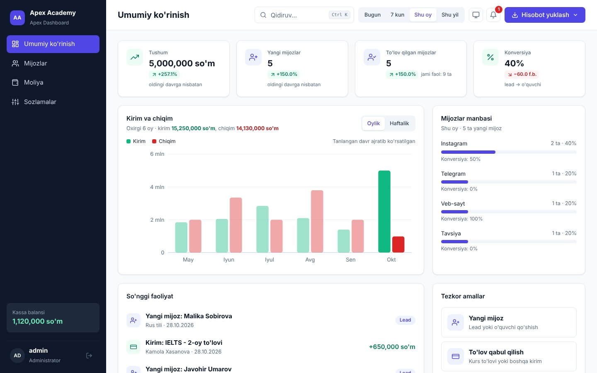
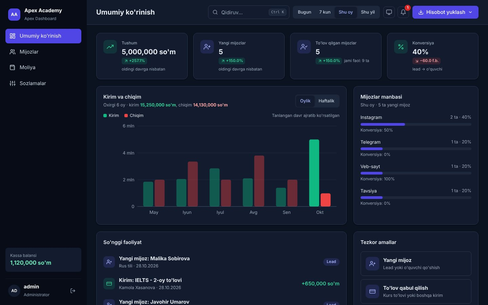
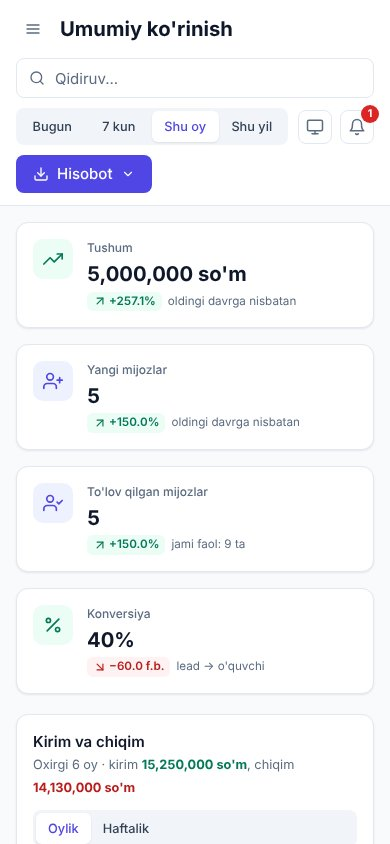

# Apex Dashboard

**Ta'lim markazlari va kichik biznes uchun CRM boshqaruv paneli.** Mijozlar bazasi, to'lovlar, kassa balansi, hisobotlar va
analitika — bitta brauzer ilovasida. Interfeys to'liq o'zbek tilida (lotin), mobil qurilmalar va qorong'i mavzu qo'llab-quvvatlanadi.



| Qorong'i mavzu                                   | Mobil (390 px)                         |
| ------------------------------------------------ | -------------------------------------- |
|          |     |

> Skrinshotlar `docs/` papkasida. O'z brendingiz bilan yangilash uchun ularni almashtiring.

---

## Imkoniyatlar

**Umumiy ko'rinish**

- 4 ta KPI: tushum, yangi mijozlar, to'lov qilgan mijozlar, konversiya — oldingi teng davrga nisbatan trend bilan
- Kirim va chiqim grafigi: oylik / haftalik, tooltip, klaviatura bilan navigatsiya
- Mijozlar manbasi (soni, ulushi, konversiyasi), so'nggi faoliyat, tezkor amallar
- Barcha ko'rsatkichlar yuqoridagi davr tanlovi (Bugun / 7 kun / Shu oy / Shu yil) bilan sinxron

**Mijozlar**

- Qidiruv (ism, telefon, kurs, email), holat / kurs / manba filtrlari, saralash, sahifalash (10 / 20 / 50)
- Qo'shish va tahrirlash: `+998 XX XXX XX XX` maskasi, email tekshiruvi, takroriy telefon taqiqlanadi
- Holatni jadvalning o'zida almashtirish, mijoz kartasi (to'lovlar tarixi, jami to'lov)

**Moliya**

- Kirim / chiqim jurnali: tur, usul, kategoriya, sana oralig'i filtrlari, saralash, tahrirlash
- To'lov formasi: qidiruvli mijoz tanlash, minglik ajratgichli summa, Kirim / Chiqim kategoriyalari
- To'lov usullari va xarajatlar tarkibi bo'yicha taqsimot, kassa balansi

**Hisobotlar va ma'lumotlar**

- CSV (UTF-8 BOM, `;` yoki `,`) va Excel (.xls) eksport — joriy filtrlangan ro'yxatdan
- To'liq JSON zaxira va zaxiradan tiklash (oldindan ko'rish va tasdiqlash bilan)
- Sxema versiyasi va migratsiyalar, buzuq yozuvlarni avtomatik tashlab yuborish
- Bir nechta tab ochiq bo'lsa ma'lumotlar sinxronlanadi

**Sozlamalar va xavfsizlik**

- Tashkilot (nom, logo harflari, telefon, manzil), mintaqa (valyuta, sana formati, CSV ajratgich), kurslar ro'yxati
- Login va parolni almashtirish, saqlanmagan o'zgarishlar haqida ogohlantirish
- Bildirishnomalar: javobsiz leadlar, oylik chiqim kirimdan oshishi, manfiy balans

**UI/UX**

- Yorug' / qorong'i / tizim mavzusi, WCAG AA kontrast
- Responsiv: 1440 / 1024 / 768 / 390 px; mobilda jadvallar kartalarga aylanadi
- Klaviatura: `Ctrl/Cmd + K` — qidiruv, `N` — yangi mijoz, fokus tuzog'i, skip link
- Toast xabarlari, animatsiyalar (`prefers-reduced-motion` hurmat qilinadi)

## Texnologiyalar

React 19 · TypeScript 7 · Vite 8 · React Compiler · Vitest. Runtime bog'liqlik faqat `react` va `react-dom` — router, UI, grafik
yoki sana kutubxonalari ishlatilmagan. Stillar toza CSS (CSS variables), grafiklar qo'lda yozilgan SVG.

## O'rnatish va ishga tushirish

Talab: **Node.js 20.19+** (tavsiya: 22, `.nvmrc` da ko'rsatilgan).

```bash
npm install
npm run dev
```

Brauzerda `http://localhost:5173` ni oching.

## Standart kirish

| Login   | Parol      |
| ------- | ---------- |
| `admin` | `admin123` |

Birinchi kirishda parolni almashtirish taklif qilinadi (Sozlamalar → Xavfsizlik). Yangi parol kamida 8 ta belgi.

## Scriptlar

| Buyruq               | Vazifasi                                               |
| -------------------- | ------------------------------------------------------ |
| `npm run dev`        | Ishlab chiqish serveri                                 |
| `npm run build`      | Tur tekshiruvi va production build (`dist/`)           |
| `npm run preview`    | Build natijasini lokal ko'rish                         |
| `npm run lint`       | Oxlint (ogohlantirishlar ham xato hisoblanadi)         |
| `npm run test`       | Vitest testlari (bir marta)                            |
| `npm run test:watch` | Testlar kuzatuv rejimida                               |
| `npm run typecheck`  | Faqat TypeScript tekshiruvi                            |
| `npm run check`      | typecheck + lint + test + build — deploydan oldin      |

## Papkalar tuzilishi

```
src/
├── components/
│   ├── auth/          Kirish ekrani, parol almashtirish taklifi
│   ├── customers/     Mijozlar jadvali, forma, mijoz kartasi
│   ├── finance/       Tranzaksiyalar jurnali, forma, taqsimotlar
│   ├── layout/        Sidebar, Header, bildirishnomalar, mavzu
│   ├── overview/      KPI, grafik, manbalar, faoliyat, tezkor amallar
│   ├── settings/      Sozlamalar bo'limlari
│   └── ui/            Umumiy komponentlar: Button, Input, Select, Modal,
│                      ConfirmDialog, Dropdown, Combobox, Toast, Pagination ...
├── constants/         Navigatsiya, ikonlar (inline SVG), yorliqlar, demo ma'lumot
├── context/           Dashboard, Auth va Theme provayderlari
├── hooks/             useAuth, useToast, useConfirm, useTheme, useNotifications
├── services/          storage (versiya, migratsiya), export (CSV/XLS), auth
├── types/             Customer, Transaction, Settings va boshqa turlar
├── utils/             analytics, format, guards, phone, list, reports ...
└── index.css          Dizayn tokenlari (yorug'/qorong'i) va barcha stillar
```

Testlar tekshirilayotgan fayl yonida joylashgan (`*.test.ts`).

## Ma'lumotlar qayerda saqlanadi

Backend yo'q — barcha ma'lumot **foydalanuvchi brauzerining `localStorage`'ida** saqlanadi:

| Kalit                                                | Tarkibi                                          |
| ---------------------------------------------------- | ------------------------------------------------ |
| `apex:customers`, `apex:transactions`, `apex:settings` | Asosiy ma'lumotlar                             |
| `apex:version`                                       | Sxema versiyasi (migratsiyalar uchun)            |
| `apex:auth`                                          | Login va parol hashi (SHA-256, tuz bilan)        |
| `apex:theme`, `apex:notifications`                   | Mavzu va o'qilgan eslatmalar                     |
| `apex:session` (sessionStorage)                      | Joriy sessiya — tab yopilganda tugaydi           |

Birinchi ochilishda demo ma'lumotlar yoziladi. Boshqa brauzer yoki qurilmada ma'lumotlar ko'rinmaydi — ko'chirish uchun
**Sozlamalar → Ma'lumotlar → JSON zaxira** dan foydalaning. Brauzer tarixini tozalash ma'lumotlarni ham o'chiradi, shuning uchun
zaxirani muntazam yuklab oling.

## Deploy

### Vercel

1. Repozitoriyni GitHub'ga yuklang va [vercel.com](https://vercel.com) da **Add New → Project** orqali import qiling.
2. Sozlamalar `vercel.json` dan avtomatik olinadi (build: `npm run build`, chiqish: `dist`, SPA rewrite, kesh headerlari).
3. **Deploy** tugmasini bosing.

### Netlify

1. [app.netlify.com](https://app.netlify.com) da **Add new site → Import an existing project** ni tanlang.
2. Sozlamalar `netlify.toml` dan olinadi (Node 22, `dist`, SPA redirect, kesh headerlari).
3. **Deploy site** ni bosing.

Deploydan so'ng `index.html` dagi `og:image` ni to'liq manzil bilan almashtiring (masalan, `https://sizning-domen.uz/og-image.jpg`) —
ijtimoiy tarmoqlardagi ko'rinish uchun.

> Parol hashi Web Crypto API orqali hisoblanadi va u faqat **HTTPS** yoki `localhost` da ishlaydi. Vercel va Netlify
> avtomatik HTTPS beradi.

## Cheklovlar

- **Bu faqat frontend darajasidagi himoya.** Login va parol brauzerda tekshiriladi; texnik bilimga ega foydalanuvchi
  `localStorage` orqali uni chetlab o'tishi yoki ma'lumotlarni o'zgartirishi mumkin. Haqiqiy xavfsizlik, ko'p foydalanuvchi va
  rollar uchun **backend kerak**.
- Ma'lumotlar bitta brauzerga bog'langan, sinxron serverga yozilmaydi. `localStorage` hajmi taxminan 5 MB bilan cheklangan.
- Valyutani USD ga o'zgartirish faqat belgini almashtiradi — summalar konvertatsiya qilinmaydi.
- CSV'da `=`, `+`, `-`, `@` bilan boshlangan matnlar (masalan, `+998...` telefonlar) Excel formula sifatida bajarilmasligi uchun
  `'` belgisi bilan boshlanadi. Telefonlar toza ko'rinishi kerak bo'lsa, Excel (.xls) eksportidan foydalaning.

## Keyingi rivojlanish

- Backend (masalan, Supabase / PostgreSQL): server tomonda autentifikatsiya, bir nechta qurilmada ishlash
- Ko'p foydalanuvchi va rollar (direktor, administrator, o'qituvchi, buxgalter)
- SMS va Telegram bot orqali eslatmalar (to'lov muddati, dars jadvali)
- Payme / Click API integratsiyasi: to'lovlarni avtomatik qayd etish
- Guruhlar, dars jadvali va davomat moduli
