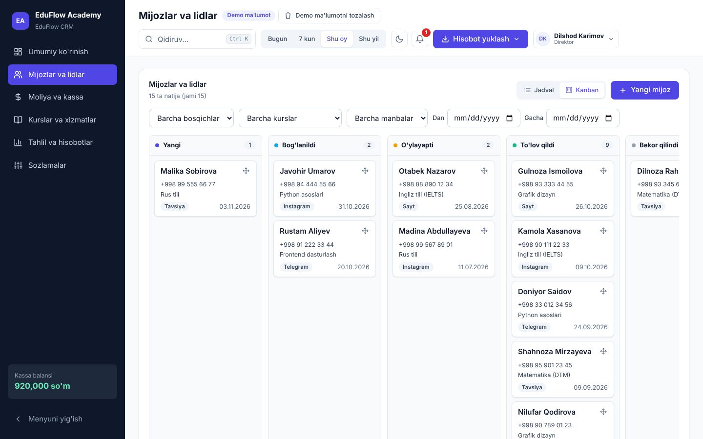

# EduFlow CRM

[](https://github.com/Ulugbek-Ar/eduflow-crm/actions/workflows/ci.yml) · versiya 1.0.0

**Ta'lim markazlari va kichik biznes uchun CRM boshqaruv paneli.** Mijozlar bazasi, to'lovlar, kassa balansi, hisobotlar va
analitika — bitta brauzer ilovasida. Interfeys to'liq o'zbek tilida (lotin), mobil qurilmalar va qorong'i mavzu qo'llab-quvvatlanadi.

| Yorug' mavzu                                              | Qorong'i mavzu                                         |
| --------------------------------------------------------- | ------------------------------------------------------ |
|               |   |
|            |               |
|                   |     |
|            |  |
|                         |         |

> Skrinshotlar `docs/` papkasida, demo ma'lumot bilan production build'dan (`npm run preview`) olingan.

---

## Imkoniyatlar

Bo'limlar (sidebar tartibida): **Umumiy ko'rinish · Mijozlar va lidlar · Moliya va kassa · Kurslar va xizmatlar ·
Tahlil va hisobotlar · Sozlamalar**. Barcha hisob-kitoblar Header'dagi umumiy davr tanlovi (Bugun / 7 kun / Shu oy / Shu yil)
bilan sinxron.

**Layout**

- Sidebar yig'iladi: to'liq (ikonka + nom) va ixcham (faqat ikonka, nom tooltip'da) — holat saqlanadi; mobilda chiqib keladigan menyu
- Header: global qidiruv (`Ctrl/Cmd + K`), bildirishnomalar, bitta tugmali yorug'/qorong'i mavzu, profil menyusi (ism, rol, Profil, Chiqish)

**Umumiy ko'rinish**

- 4 ta KPI: Jami tushum, Faol mijozlar ("To'lov qildi"), Yangi lidlar (davrda kelganlar), Konversiya — oldingi teng davrga nisbatan trend
- Oylik tushum va xarajatlar grafigi (qo'lda yozilgan SVG, oylik / haftalik, klaviatura bilan), manbalar taqsimoti,
  so'nggi amallar lentasi (bosqich va to'lov statusi bilan), tezkor amallar

**Mijozlar va lidlar — sotuv voronkasi**

- Bosqichlar: **Yangi → Bog'lanildi → O'ylayapti → To'lov qildi → Bekor qilindi**
- Ikki ko'rinish (tanlov saqlanadi): **Jadval** (saralash, sahifalash, bosqichni jadvalning o'zida almashtirish) va
  **Kanban** (ustun sarlavhasida mijozlar soni; kartani sichqoncha bilan sudrab o'tkazish; klaviaturada — kartadagi
  bosqich menyusi yoki `Alt + ←/→`, `Enter` — kartani ochish). Mobilda Kanban faqat o'z ichida gorizontal aylanadi
- Yangi mijoz: Ism, Telefon (`+998 XX XXX XX XX` maskasi, takroriy raqam taqiqlanadi), Manba, Kurs/Xizmat, Izoh
- Qidiruv va filtrlar: bosqich, manba, kurs, qo'shilgan sana oralig'i
- Mijoz kartasi: to'lovlar tarixi (statuslari bilan), jami to'langan, joriy oy qarzi; tahrirlash, tasdiqlash bilan o'chirish
  (to'lovlar jurnalda "Ism (o'chirilgan)" ko'rinishida qoladi)

**Moliya va kassa**

- Yuqorida: umumiy balans (kassa), jami kirim, jami chiqim (tanlangan davr)
- To'lovlar jadvali: Sana, Mijoz, Summa, To'lov turi (Naqd / Karta / O'tkazma), Status (To'langan / Kutilmoqda /
  Bekor qilingan — jadvalning o'zida almashtiriladi). **Balans va barcha KPI faqat "To'langan" bo'yicha hisoblanadi**
- Kirim / Chiqim formasi; marketing chiqimiga ixtiyoriy **Manba** (CPL/ROI uchun)
- **Qarzdorliklar va kutilayotgan to'lovlar**: qarzi kattasidan saralangan ro'yxat, qatordan "To'lov qabul qilish"
  (summa oldindan to'ldiriladi); "Kutilmoqda" to'lovlarni bir bosishda "To'landi" deb belgilash
- To'lov turlari va xarajatlar tarkibi bo'yicha taqsimot

**Kurslar va xizmatlar**

- Nom, turi (kurs / xizmat), davomiyligi (oy), oylik narxi, faol guruhlar soni, holati (faol / arxiv)
- Har bir kursda talabalar soni ("To'lov qildi"), jami lidlar, oylik kutilayotgan tushum (talabalar × narx)
- Qo'shish, tahrirlash (nom o'zgarsa mijozlardagi kurs nomi ham yangilanadi), arxivlash/qaytarish; mijozi bor kurs
  o'chirilmaydi — arxivlanadi

**Tahlil va hisobotlar**

- O'rtacha chek (AOV), to'langan kirim, marketing chiqimi, konversiya
- Manbalar samaradorligi: lidlar, "To'lov qildi", konversiya, marketing chiqimi, CPL, ROI (Jami qatori bilan)
- CSV va Excel eksport: mijozlar, tranzaksiyalar, qarzdorlar, manbalar hisoboti (CSV injection himoyasi bilan)

**Sozlamalar**

- Tashkilot: nom, logotip (rasm, 200 KB gacha; yo'q bo'lsa harfli logo), telefon, manzil
- Mintaqa va ko'rinish: asosiy valyuta (UZS / USD), sana formati, CSV ajratgich, mavzu (yorug' / qorong'i / tizim)
- Profil va xavfsizlik: to'liq ism, rol/lavozim, login va parolni almashtirish
- Ma'lumotlar: JSON zaxira, zaxiradan tiklash, demo ma'lumot, tasdiqlash bilan **barcha ma'lumotni tozalash (Reset)**,
  taxminiy band joy (KB va ~5 MB ga nisbatan %)

**Umumiy**

- Birinchi kirishda tanlov: **Bo'sh boshlash** yoki **Demo ma'lumot bilan tanishish**; demo rejimda Header'da belgi va tozalash
- Saqlash xatosi (xotira to'lgan) haqida aniq ogohlantirish; bir nechta tab orasida sinxronlash
- Bildirishnomalar: bog'lanilmagan yangi lidlar, joriy oy qarzdorlari, chiqim kirimdan oshishi, manfiy balans
- Parol PBKDF2-HMAC-SHA256 (210 000 iteratsiya); noto'g'ri urinishlarda o'sib boruvchi blok
- Yorug' / qorong'i / tizim mavzusi, ranglar faqat CSS o'zgaruvchilaridan, WCAG AA kontrast (ikkala mavzuda tekshirilgan)
- Responsiv: 1440 / 1024 / 768 / 390 px; mobilda jadvallar kartalarga aylanadi, sahifada gorizontal scroll yo'q
- Klaviatura: `Ctrl/Cmd + K` — qidiruv, `N` — yangi mijoz, fokus tuzog'i, skip link

## Hisob qoidalari va formulalar

Barcha formulalar sof funksiyalar va testlar bilan: `src/utils/analytics.ts`, `src/utils/debts.ts`, `src/utils/courses.ts`.

| Ko'rsatkich | Formula |
| --- | --- |
| Kassa balansi | barcha vaqtdagi "To'langan" kirim − "To'langan" chiqim |
| Jami tushum | davrdagi "To'langan" kirimlar |
| Faol mijozlar | "To'lov qildi" bosqichidagi mijozlar (davr oxiri holati, qo'shilgan sana bo'yicha) |
| Yangi lidlar | davrda qo'shilgan mijozlar (istalgan bosqichda) |
| Konversiya | davrda kelgan lidlardan "To'lov qildi" bosqichidagilar ulushi; trend — foiz bandida |
| O'rtacha chek (AOV) | davrdagi "To'langan" kirimlar summasi / ular soni |
| CPL | manba bo'yicha "To'langan" marketing chiqimi / davrda shu manbadan kelgan lidlar |
| ROI | (shu manbadan kelgan mijozlarning davrdagi kirimi − chiqim) / chiqim × 100 |
| Kurs: kutilayotgan tushum | "To'lov qildi" talabalar soni × oylik narx |

Chiqim (yoki lid) 0 bo'lsa CPL va ROI **"—"** ko'rsatiladi — nolga bo'linmaydi. "Jami" qatori o'rtachalardan emas, yig'indilardan
qayta hisoblanadi.

**Qarzdorlik (joriy kalendar oyi):**

1. Faqat **"To'lov qildi"** bosqichidagi mijozlar hisoblanadi.
2. Kutilgan summa = mijoz kursining **oylik narxi**. Kurs topilmasa yoki narxi 0 bo'lsa, mijoz hisobga olinmaydi; arxivdagi kurs hisoblanadi.
3. To'langan = shu mijozning joriy oydagi **"To'langan"** kirimlari. "Kutilmoqda" va "Bekor qilingan" kirmaydi.
4. Qarz = max(0, kutilgan − to'langan); ortiqcha to'lov keyingi oyga o'tkazilmaydi.
5. Ro'yxat qarzi kattasidan saralanadi; "Kutilmoqda" to'lovlar alohida ro'yxatda.

## Texnologiyalar

React 19 · TypeScript 7 · Vite 8 · React Compiler · Vitest · Testing Library. Runtime bog'liqlik faqat `react` va `react-dom` — router, UI, grafik
yoki sana kutubxonalari ishlatilmagan. Stillar toza CSS (CSS variables), grafiklar qo'lda yozilgan SVG.

## O'rnatish va ishga tushirish

Talab: **Node.js 20.19+** (tavsiya: 22, `.nvmrc` da ko'rsatilgan).

```bash
npm install
npm run dev
```

Brauzerda `http://localhost:5173` ni oching.

## Standart kirish

| Login   | Parol      |
| ------- | ---------- |
| `admin` | `admin123` |

Birinchi kirishda parolni almashtirish taklif qilinadi (Sozlamalar → Profil va xavfsizlik). Yangi parol kamida 8 ta belgi.

Ketma-ket 5 ta noto'g'ri urinishdan keyin kirish bloklanadi: 30 s → 60 s → 120 s → … (eng ko'pi 15 daqiqa).
Blok `localStorage`'da saqlanadi — sahifani yangilash uni bekor qilmaydi. To'g'ri kirish hisoblagichni tozalaydi.
Oxirgi blok tugaganidan 24 soat o'tsa (blok bo'lmagan bo'lsa — oxirgi noto'g'ri urinishdan), hisoblagich va blok tarixi
nolga tushadi: keyingi blok yana 30 soniyadan boshlanadi.

## Scriptlar

| Buyruq               | Vazifasi                                               |
| -------------------- | ------------------------------------------------------ |
| `npm run dev`        | Ishlab chiqish serveri                                 |
| `npm run build`      | Tur tekshiruvi va production build (`dist/`)           |
| `npm run preview`    | Build natijasini lokal ko'rish (prod CSP sarlavhasi bilan) |
| `npm run lint`       | Oxlint (ogohlantirishlar ham xato hisoblanadi)         |
| `npm run test`       | Vitest: unit va komponent testlari (bir marta)         |
| `npm run test:watch` | Testlar kuzatuv rejimida                               |
| `npm run typecheck`  | Faqat TypeScript tekshiruvi                            |
| `npm run check`      | typecheck + lint + test + build — deploydan oldin      |

## Papkalar tuzilishi

```
src/
├── components/
│   ├── analytics/     Tahlil va hisobotlar (AOV, manbalar samaradorligi, eksport)
│   ├── auth/          Kirish ekrani, parol almashtirish taklifi
│   ├── courses/       Kurslar va xizmatlar ro'yxati, kurs formasi
│   ├── customers/     Mijozlar jadvali, Kanban (voronka), forma, mijoz kartasi
│   ├── finance/       To'lovlar jurnali, qarzdorlar, forma, taqsimotlar
│   ├── layout/        Sidebar (yig'iladigan), Header, profil menyusi, bildirishnomalar, mavzu
│   ├── onboarding/    Birinchi ishga tushishdagi tanlov ekrani
│   ├── overview/      KPI, grafik, manbalar, faoliyat, tezkor amallar
│   ├── settings/      Sozlamalar bo'limlari
│   └── ui/            Umumiy komponentlar: Button, Input, Select, Modal,
│                      ConfirmDialog, Dropdown, Combobox, Toast, Pagination ...
├── constants/         Ilova nomi (app.ts), navigatsiya, ikonlar (inline SVG), yorliqlar, demo ma'lumot
├── context/           Dashboard, Auth va Theme provayderlari
├── hooks/             useAuth, useToast, useConfirm, useTheme, useNotifications, useStorageUsage, usePersistentState
├── services/          storage (versiya, migratsiya, saqlash xatolari), export (CSV/XLS), auth (PBKDF2),
│                      loginLock (kirish bloki)
├── test/              Komponent testlari uchun yordamchilar (ma'lumot va sessiyani tayyorlash)
├── types/             Customer, Course, Transaction, Settings va boshqa turlar
├── utils/             analytics, debts, courses, customers, format, guards, phone, list, reports ...
└── index.css          Dizayn tokenlari (yorug'/qorong'i) va barcha stillar
```

Testlar tekshirilayotgan fayl yonida joylashgan: unit testlar `*.test.ts`, komponent testlari (Testing Library) `*.test.tsx`.
Deploy konfiguratsiyasi testlari (`vercel.json` / `netlify.toml` CSP mosligi) — `tests/` papkasida.

Har bir push va pull request'da GitHub Actions (`.github/workflows/ci.yml`) Node 22 bilan `npm ci && npm run check` ni bajaradi.

Ilova nomi faqat `src/constants/app.ts` da: `index.html` dagi `%APP_NAME%` build paytida almashtiriladi.

## Ma'lumotlar qayerda saqlanadi

Backend yo'q — barcha ma'lumot **foydalanuvchi brauzerining `localStorage`'ida** saqlanadi:

| Kalit                                                | Tarkibi                                          |
| ---------------------------------------------------- | ------------------------------------------------ |
| `apex:customers`, `apex:transactions`, `apex:courses`, `apex:settings` | Asosiy ma'lumotlar             |
| `apex:version`                                       | Sxema versiyasi (hozir 8; migratsiyalar uchun)   |
| `apex:seeded`, `apex:demo`                           | Birinchi tanlov qilingan / demo rejim            |
| `apex:auth`                                          | Login, tuz va parol xeshi (PBKDF2-SHA256, `algo` va `iterations` bilan) |
| `apex:login-lock`                                    | Noto'g'ri urinishlar hisoblagichi, blok muddati va oxirgi urinish vaqti |
| `apex:theme`, `apex:notifications`                   | Mavzu va o'qilgan eslatmalar                     |
| `apex:sidebar-collapsed`, `apex:customers-view`      | Sidebar holati, mijozlar ko'rinishi (Jadval / Kanban) |
| `apex:session` (sessionStorage)                      | Joriy sessiya — tab yopilganda tugaydi           |

Kalitlar `apex:` prefiksi bilan qoldirilgan — avvalgi versiyadagi ma'lumotlar yo'qolmasligi uchun. Eski SHA-256 parol
xeshi to'g'ri parol bilan birinchi kirishda avtomatik PBKDF2 ga yangilanadi.

### Sxema versiyalari va migratsiyalar

Migratsiyalar yozuv shakliga qarab ishlaydi (`normalizeData`): istalgan eski versiyadagi `localStorage` ham, eski JSON zaxira
ham joriy sxemaga ko'chiriladi, buzuq yozuvlar tashlab yuboriladi va soni ko'rsatiladi. Yangiroq versiyadagi zaxira rad etiladi.

| Versiya | O'zgarish | Eski → yangi |
| --- | --- | --- |
| v2 | Tranzaksiya kategoriyasi | izoh va turiga qarab taxmin |
| v3 | Tranzaksiyada mijoz ismi snapshot'i | mavjud mijozlar ismi ko'chiriladi |
| v4 | Profil: `profileName`, `profileRole` | `''`, `Administrator` |
| v5 | Mijoz holati → voronka bosqichi | `lead → new`, `active → paid`, `paused → thinking`, `left → cancelled` |
| v6 | Kurslar alohida entity (`apex:courses`) | `settings.courses` va mijozlardagi nomlar → kurs (narx 0, 1 oy, 0 guruh, faol) |
| v7 | To'lov turi, status, marketing manbasi | `payme, click → card`, `bank → transfer`, `cash → cash`; status → `paid` |
| v8 | Logotip rasmi `settings.logoImage` | `''` (harfli logo) |

Birinchi ochilishda hech narsa yozilmaydi — foydalanuvchi bo'sh yoki demo ma'lumotni tanlaydi. Boshqa brauzer yoki qurilmada ma'lumotlar ko'rinmaydi — ko'chirish uchun
**Sozlamalar → Ma'lumotlar → JSON zaxira** dan foydalaning. Brauzer tarixini tozalash ma'lumotlarni ham o'chiradi, shuning uchun
zaxirani muntazam yuklab oling.

## Deploy

### Vercel

1. Repozitoriyni GitHub'ga yuklang va [vercel.com](https://vercel.com) da **Add New → Project** orqali import qiling.
2. Sozlamalar `vercel.json` dan avtomatik olinadi (build: `npm run build`, chiqish: `dist`, SPA rewrite, kesh headerlari).
3. **Deploy** tugmasini bosing.

### Netlify

1. [app.netlify.com](https://app.netlify.com) da **Add new site → Import an existing project** ni tanlang.
2. Sozlamalar `netlify.toml` dan olinadi (Node 22, `dist`, SPA redirect, kesh headerlari).
3. **Deploy site** ni bosing.

Deploydan so'ng `index.html` dagi `og:image` ni to'liq manzil bilan almashtiring (masalan, `https://sizning-domen.uz/og-image.jpg`) —
ijtimoiy tarmoqlardagi ko'rinish uchun.

> Parol hashi Web Crypto API orqali hisoblanadi va u faqat **HTTPS** yoki `localhost` da ishlaydi. Vercel va Netlify
> avtomatik HTTPS beradi.

### Xavfsizlik sarlavhalari

`vercel.json` va `netlify.toml` bir xil `Content-Security-Policy` yuboradi:

```
default-src 'self'; script-src 'self'; style-src 'self' 'unsafe-inline'; img-src 'self' data: blob:;
font-src 'self'; connect-src 'self'; object-src 'none'; base-uri 'self'; form-action 'self'; frame-ancestors 'none'
```

- Inline skript yo'q: mavzuni oldindan qo'llovchi skript `public/theme-init.js` faylida, shuning uchun hash kerak emas.
- `'unsafe-inline'` faqat stillar uchun (React `style` atributlari: grafik va progress kengliklari).
- `npm run preview` ham shu CSP'ni yuboradi (`vite.config.ts` uni `vercel.json` dan o'qiydi) — build'ni brauzer
  konsolida CSP xatolari yo'qligiga tekshirish mumkin. CSP o'zgartirilsa, ikkala faylni yangilang: test farqni ushlaydi.
- Qo'shimcha: `X-Frame-Options: DENY`, `X-Content-Type-Options: nosniff`, `Referrer-Policy`, `Permissions-Policy`.

## Xavfsizlik: backend'siz himoyaning cheklovlari

Ochiq aytamiz: **bu ilovadagi kirish — maxfiylik emas, balki tasodifiy foydalanuvchidan himoya.** Backend bo'lmagani uchun:

- **Ma'lumotlar shifrlanmagan.** Mijozlar, telefonlar va to'lovlar `localStorage`'da ochiq JSON ko'rinishida turadi. Kompyuterga
  kira oladigan har kim DevTools orqali ularni parolsiz o'qiy, o'zgartira yoki o'chira oladi.
- **Kirishni chetlab o'tish mumkin.** Tekshiruv brauzerda bajariladi: `sessionStorage`'ga sessiya yozish, `apex:auth` ni
  o'chirish (standart `admin` / `admin123` qayta yaratiladi) yoki JavaScript'ni o'zgartirish orqali ekran ochiladi.
- **Urinishlar bloki ham mahalliy.** `apex:login-lock` ni o'chirish yoki boshqa brauzer/profil ochish blokni bekor qiladi.
  U faqat oddiy parol tanlashni sekinlashtiradi.
- **PBKDF2 nima beradi:** xesh oqib chiqsa (masalan, zaxira yoki brauzer profili nusxasi), parolni tanlab topish
  qimmatlashadi va parol boshqa saytlarda qayta ishlatilgan bo'lsa, uni himoya qiladi. Ma'lumotlarning o'zini himoya qilmaydi.
- **Bitta foydalanuvchi, rollar yo'q, audit jurnali yo'q.** Kim nimani o'zgartirganini bilib bo'lmaydi.
- **JSON zaxira ham shifrlanmagan** — uni ishonchli joyda saqlang.

Haqiqiy xavfsizlik (server tomonda autentifikatsiya, ma'lumotni shifrlash, rollar, audit) uchun **backend kerak** — pastdagi
"Keyingi rivojlanish" bo'limiga qarang. Hozirgi holatda ilovani faqat o'zingiz nazorat qiladigan qurilmada ishlating va
operatsion tizim hisobiga parol qo'ying.

## Cheklovlar

- Ma'lumotlar bitta brauzerga bog'langan, sinxron serverga yozilmaydi. `localStorage` hajmi taxminan 5 MB bilan cheklangan
  (aniq limit brauzerga bog'liq, band joy ko'rsatkichi taxminiy). Xotira to'lsa, yangi o'zgarishlar faqat ochiq tabda qoladi —
  ogohlantirish chiqqanda darhol JSON zaxira oling.
- Valyutani USD ga o'zgartirish faqat belgini almashtiradi — summalar konvertatsiya qilinmaydi.
- Bosqich o'zgarishlari tarixi saqlanmaydi: "Faol mijozlar" trendi va konversiya joriy bosqich va qo'shilgan sana bo'yicha
  hisoblanadi (lid qachon "To'lov qildi" ga o'tganini bilib bo'lmaydi).
- Qarz faqat joriy oy uchun va "oylik narx" modelida: o'tgan oylardan qolgan qarz, chegirmalar va bir martalik to'lovlar
  hisobga olinmaydi. Mijoz kursga nom orqali bog'langan.
- Logotip `localStorage`'da data URL sifatida saqlanadi (200 KB gacha) — band joyni oshiradi.
- CSV'da `=`, `+`, `-`, `@` bilan boshlangan matnlar (masalan, `+998...` telefonlar) Excel formula sifatida bajarilmasligi uchun
  `'` belgisi bilan boshlanadi. Telefonlar toza ko'rinishi kerak bo'lsa, Excel (.xls) eksportidan foydalaning.

## Keyingi rivojlanish

- Backend (masalan, Supabase / PostgreSQL): server tomonda autentifikatsiya, bir nechta qurilmada ishlash
- Ko'p foydalanuvchi va rollar (direktor, administrator, o'qituvchi, buxgalter)
- SMS va Telegram bot orqali eslatmalar (to'lov muddati, dars jadvali)
- Payme / Click API integratsiyasi: to'lovlarni avtomatik qayd etish
- Guruhlar, dars jadvali va davomat moduli
